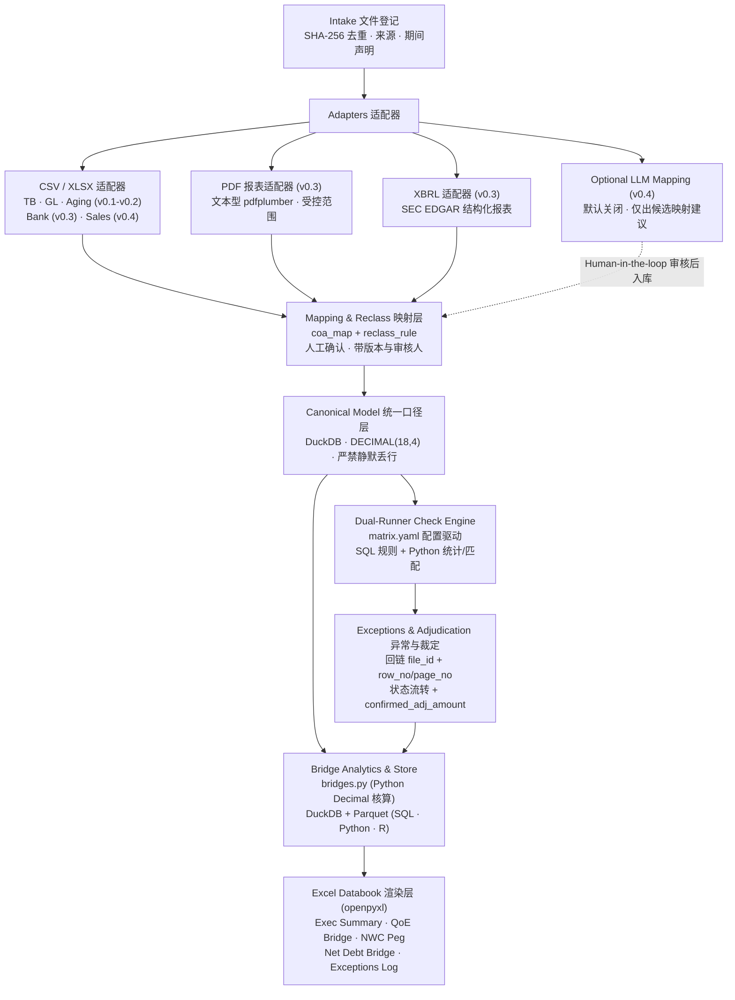

# FDD Workbench · 财务尽调分析工作台

> **Status: Engineering Specification + Project Scaffold (pre-business-implementation).**
> 架构、统一数据模型（Canonical DDL）、检查矩阵与工程实施规范均已冻结。已建立 Python 包骨架、依赖声明与 Ruff / pytest 配置，尚未开始编写业务代码。初始概念设计稿归档于 [docs/design-v1.md](docs/design-v1.md)。

开发环境初始化（Python 3.11+）：

```bash
python3.11 -m venv .venv
source .venv/bin/activate
python -m pip install -e '.[dev]'
ruff check .
python -m pytest
```

当前仅包含包导入冒烟检查；下文的 `fddw` 命令、Schema、检查规则及输出均为待实现规范。

> Import a target company's financial files — structured accounting exports (`CSV` / `XLSX`) or public filings (`PDF` / `XBRL`) — normalize them onto one auditable canonical model in DuckDB, run a configurable dual-runner (`SQL` + `Python`) financial due diligence (FDD) check matrix, adjudicate findings into quantified deal adjustments (`QoE` / `NWC Peg` / `Net Debt`), and export both a query-ready DuckDB/Parquet analysis store and a rendered Excel Databook.

A tool, not a narrative. It does not ship a story about a fake company. It ships adapters, a unified data model, a check engine driven by a matrix, deterministic bridge calculations, and rule-triggering test fixtures that prove every check fires accurately.

---

## 1. 这是什么 / 给谁用 / 不是什么

**一句话定位**：面向**交易服务（Transaction Services）/ 财务尽职调查（FDD）分析师**的本地账套核查与底稿生成工具——将目标公司异构财务导出文件洗成可逐行溯源的统一口径，按矩阵批量执行完整性与盈利质量核查，并将经分析师裁定的异常联动汇总为 **Adjusted EBITDA（QoE）、NWC Peg、Net Debt & Debt-like** 三大交易桥梁底稿。

### 解决的核心问题

FDD 实务中处理目标公司账套时，普遍存在三个工程痛点：

1. **异构导出缺乏行级证据链**：目标公司提供的试算平衡表（TB）、总账序时账（GL）、应收/应付账龄、银行流水格式各异（用友、金蝶、SAP、手工台账）。手工整理进 Excel 后，在项目复核、管理层访谈（Q&A）或 SPA 价格谈判被追问“这笔调整源自哪里”时，难以快速反查到**原始文件哈希、页码或行号**。
2. **异常排查与 Databook 桥梁手工割裂**：核查发现的非经常性损益、跨期突击收入、账龄恶化、潜伏类债务（Debt-like），往往依赖手工摘录粘贴进 QoE / NWC / Net Debt 汇总表；一旦补充期后数据或调整裁定结论，整套底稿极易漏调或口径失真。
3. **跨期间混算与跨项目难复用**：同一标的常同时存在管理层月报（Management）与审计年报（Audited）、合并口径与单体口径，手工汇总易重复计入；换下一家目标公司时，科目映射与核查脚本又要推倒重写。

### 给谁用

1. **第一受众 — 交易服务 / FDD 分析师**（四大会计师事务所 TS、精品财务顾问、买方投后与尽调团队）：用于标准化账套清洗、多维度自动化核查、行级证据留痕、异常状态流转及标准 Excel Databook 生成。
2. **第二受众 — 买方投资经理 / 并购与战略投资分析师**：在对非上市目标公司账套做快速财务诊断时，直接获取经核查验证的估值与交易价格调整输入（Adjusted EBITDA、NWC Peg、Net Debt）。
3. **作者本人**：作为面向**交易服务 / FDD 岗位**的工具作品集，证明“理解真实 FDD 核查逻辑与交易价格调整机制，并能将其实现为可测试、可复现的数据工程系统”。

### 不是什么（明确边界）

- **不是**估值建模工具（DCF / LBO / 三表预测）或二级市场行情终端；本工具产出估值模型和 SPA 价格调整机制所需的**上游清洗结果（QoE、NWC Peg、Net Debt）**。
- **不是**法定审计软件，不出具审计意见。
- **不是**“AI 一键读财报下结论”的黑盒工具。**确定性核算放内核，概率性 LLM 放可选边缘且必须经人工审核确认**；不承诺任何非标脏 PDF 都能全自动无误提取。
- **不包含**编造的“问题公司”商业故事数据集；所有内置样例数据均为明确标注 `SIMULATED` 的极简规则触发测试集或合规公开披露报表（见 §7、§11）。

---

## 2. 系统架构与人机边界



### 分层职责与关键约束

| 层 | 职责 | 硬性约束 |
|---|---|---|
| **Intake** | 登记源文件元数据、计算 SHA-256、记录导入上下文 | 同哈希禁止重复导入；原始文件严格只读不改 |
| **Adapters** | 将外部格式解析为标准中间行 + 源文件定位信息 | 一格式一模块；支持表头别名、千分位、括号负数、BOM/编码容错；解析失败显式报错或降级待确认，**绝不静默丢行** |
| **Mapping & Reclass** | 本地科目/表项 $\rightarrow$ 标准 FDD 科目树 + 条件重分类 | 映射显式带版本号与审核人，跨期/跨项目可复用；未映射项进入待确认队列并触发完整性阻断告警 |
| **Canonical** | 固定 Schema、精确数值类型、统一符号与口径边界 | 所有金额采用 `DECIMAL(18, 4)`；保留原币种原精度；下游所有检查与桥梁只读这一层 |
| **Check Engine** | 读取 `checks/matrix.yaml`，调度 `sql` 或 `python` runner | 规则配置化；每条检查绑定默认 `deal_impact_type` 及正/反测试 fixture |
| **Adjudication** | 分析师对异常执行状态流转与调整金额确认 | 异常不物理删除，仅变更状态并留痕；仅 `status = 'confirmed_adj'` 的记录进入桥梁调增/调减汇总 |
| **Analytics & Outputs** | Python 层算出三大桥梁数据集，导出 DuckDB/Parquet 并渲染 Excel Databook | **核算与渲染解耦**：`analytics/bridges.py` 先用 `Decimal` 算出确定性结果并接受 `pytest` 断言；`openpyxl` 仅作渲染层，公式作为可选增强 |

### 确定性内核 vs. 边缘 AI 原则

- **内核 100% 确定性**：文件入库、映射重分类、检查执行、QoE / NWC / Net Debt 汇总全部由可复现、可单元测试的 SQL 与 Python 代码完成。
- **AI 仅作可选边缘插件**：`llm_mapping.py`（v0.4）默认关闭；启用时仅针对未知本地科目名给出候选映射建议 CSV，**必须经分析师人工审核并记录 `reviewer` 后才写入 `coa_map`**。涉密非上市标的项目可在纯离线环境运行全部核心流程。

---

## 3. Canonical Model（统一口径与 Schema 规范）

### 3.1 必须守住的 5 条财务建模规则

1. **损益类科目期末结转规则与符号约定（适配用友/金蝶等国内财务软件）**
   - 国内账套月结/年结后，损益类科目（Revenue / COGS / Opex）结转至“本年利润”，期末余额 `closing` 常为 `0`。`trial_balance` 必须区分资产负债表与利润表取数：`BS` 类科目取 `closing`；`IS` 类科目优先取 `ytd_debit` / `ytd_credit`（或当期净发生额 / `is_pre_closing = true` 口径），防止全年收入与费用在年末汇总归零。
   - **统一符号约定**：`trial_balance` 中有符号余额（`opening`、`closing`）及净发生额统一按**借正贷负**存储；转换为报表与桥梁的自然业务方向时，统一乘以 `std_account.normal_sign`（借方正常余额如资产/成本费用为 `+1`，贷方正常余额如负债/权益/收入为 `-1`），杜绝收入、应付账款或净债务出现正负反号。
2. **口径隔离（`grain` / `basis` / `consolidation_scope` 防混算）**
   - 同一标的公司常同时导入月度管理层报表（`month` + `management`）与年度审计报表（`year` + `audited`），或合并口径（`consolidated`）与单体口径（`standalone`）。
   - `period` 表强制包含 `grain`、`basis`、`consolidation_scope` 三个维度；Check Engine 与 `bridges.py` 必须显式锁定单一目标口径，严禁跨 `grain`、跨 `basis` 或跨 `consolidation_scope` 直接 `SUM`。
3. **一对多科目重分类（`coa_map` + `reclass_rule`）**
   - 实务中“其他应付款”“其他应收款”“管理费用-其他”极少能一刀切 1-to-1 映射（例如同一“其他应付款”科目下既有日常经营押金［属 NWC］，又有股东拆借或应付设备款［属 Debt-like］）。
   - 在科目级静态映射 `coa_map` 之上，设立更高优先级的条件重分类表 `reclass_rule`，支持按往来方正则、摘要关键词或凭证号在明细层覆盖目标 `std_code`。
4. **凭证内对方科目分析能力（`gl_entry`）**
   - `gl_entry` 强制保留 `voucher_line_no`（同张凭证内分录行号），支持按 `(entity_id, period_id, voucher_no)` 聚合分析**对方科目分布**（例如核查贷记“主营业务收入”时，借方究竟对应正常货币资金/应收账款，还是异常挂账的其他应收/预付/在建工程）。
   - 同时保留 `raw_counterparty` 原始文本，避免源表缺失标准往来编码时丢失辅助核算线索。
5. **异常裁定与交易桥梁打通（`exception` $\rightarrow$ Deal Bridges）**
   - 异常表不仅记录问题，还直接驱动交易价格调整：每条异常绑定统一的 `deal_impact_type` 枚举（`qoe_ebitda` | `nwc_peg` | `net_debt` | `integrity_blocker` | `info_only`）。分析师裁定为 `confirmed_adj` 并填入有符号调整额 `confirmed_adj_amount` 与 `recurring_flag` 后，`analytics/bridges.py` 自动将其纳入对应桥梁计算。

### 3.2 核心表结构（DuckDB DDL 规范）

实现时以此 Schema 为准编写 `src/fdd_workbench/model/schema.sql`：

```sql
-- 1. 主数据：被分析公司 / 法人实体（v0.4 可扩展可比公司属性）
CREATE TABLE IF NOT EXISTS entity (
    entity_id VARCHAR PRIMARY KEY,
    name VARCHAR NOT NULL,
    market VARCHAR,                         -- 'CN_PRIVATE' | 'A_SHARE' | 'HKEX' | 'US_SEC'
    reporting_currency VARCHAR(10) NOT NULL DEFAULT 'CNY',
    fiscal_year_end VARCHAR(5) NOT NULL DEFAULT '12-31',
    created_at TIMESTAMP DEFAULT CURRENT_TIMESTAMP
);

-- 2. 主数据：报告期与口径边界
CREATE TABLE IF NOT EXISTS period (
    period_id VARCHAR PRIMARY KEY,          -- e.g. 'ENT01_2025M12_MGMT_CONS'
    entity_id VARCHAR NOT NULL REFERENCES entity(entity_id),
    start_date DATE NOT NULL,
    end_date DATE NOT NULL,
    grain VARCHAR NOT NULL,                 -- 'month' | 'quarter' | 'year'
    basis VARCHAR NOT NULL,                 -- 'audited' | 'management' | 'unaudited'
    consolidation_scope VARCHAR NOT NULL DEFAULT 'consolidated', -- 'consolidated' | 'standalone'
    UNIQUE (entity_id, start_date, end_date, grain, basis, consolidation_scope)
);

-- 3. 主数据：源文件登记与不可变哈希
CREATE TABLE IF NOT EXISTS source_file (
    file_id VARCHAR PRIMARY KEY,
    entity_id VARCHAR NOT NULL REFERENCES entity(entity_id),
    path VARCHAR NOT NULL,
    sha256 VARCHAR(64) NOT NULL UNIQUE,
    kind VARCHAR NOT NULL,                  -- 'tb' | 'gl' | 'ar_aging' | 'ap_aging' | 'bank' | 'statement' | 'sales'
    imported_at TIMESTAMP DEFAULT CURRENT_TIMESTAMP,
    row_count INTEGER,
    page_count INTEGER,
    notes VARCHAR
);

-- 4. 标准 FDD 科目树
CREATE TABLE IF NOT EXISTS std_account (
    std_code VARCHAR PRIMARY KEY,
    name VARCHAR NOT NULL,
    name_zh VARCHAR,
    statement VARCHAR NOT NULL,             -- 'IS' | 'BS' | 'CF'
    category VARCHAR NOT NULL,              -- 'revenue' | 'cogs' | 'opex_sm' | 'opex_ga' | 'opex_rd' | 'da' | 'interest' | 'tax' | 'non_op' | 'nwc_ar' | 'nwc_inventory' | 'nwc_ap' | 'nwc_other' | 'cash' | 'debt' | 'debt_like' | 'equity' | 'other'
    normal_sign INTEGER NOT NULL,           -- 1 (借方正常: 资产/成本费用) | -1 (贷方正常: 负债/权益/收入)
    is_ebitda_component BOOLEAN NOT NULL DEFAULT FALSE,
    is_nwc_component BOOLEAN NOT NULL DEFAULT FALSE,
    is_net_debt_component BOOLEAN NOT NULL DEFAULT FALSE
);

-- 5. 本地科目表与科目级映射
CREATE TABLE IF NOT EXISTS coa_local (
    entity_id VARCHAR NOT NULL REFERENCES entity(entity_id),
    local_code VARCHAR NOT NULL,
    local_name VARCHAR NOT NULL,
    PRIMARY KEY (entity_id, local_code)
);

CREATE TABLE IF NOT EXISTS coa_map (
    map_id VARCHAR PRIMARY KEY,
    entity_id VARCHAR NOT NULL,
    local_code VARCHAR NOT NULL,
    std_code VARCHAR NOT NULL REFERENCES std_account(std_code),
    mapping_version INTEGER NOT NULL DEFAULT 1,
    source VARCHAR NOT NULL DEFAULT 'manual', -- 'manual' | 'rule' | 'llm_confirmed'
    reviewer VARCHAR NOT NULL,
    reviewed_at TIMESTAMP NOT NULL DEFAULT CURRENT_TIMESTAMP,
    FOREIGN KEY (entity_id, local_code) REFERENCES coa_local(entity_id, local_code),
    UNIQUE (entity_id, local_code, mapping_version)
);

-- 6. 条件重分类规则（优先级高于 coa_map，解决一对多拆账）
CREATE TABLE IF NOT EXISTS reclass_rule (
    rule_id VARCHAR PRIMARY KEY,
    entity_id VARCHAR NOT NULL REFERENCES entity(entity_id),
    priority INTEGER NOT NULL DEFAULT 100,  -- 数字越小优先级越高
    target_table VARCHAR NOT NULL,          -- 'gl_entry' | 'trial_balance' | 'aging_balance'
    match_local_code VARCHAR,
    match_counterparty_regex VARCHAR,
    match_description_regex VARCHAR,
    override_std_code VARCHAR NOT NULL REFERENCES std_account(std_code),
    reason VARCHAR NOT NULL,
    reviewer VARCHAR NOT NULL,
    active BOOLEAN NOT NULL DEFAULT TRUE
);

-- 7. 往来方主数据
CREATE TABLE IF NOT EXISTS counterparty (
    counterparty_id VARCHAR PRIMARY KEY,
    entity_id VARCHAR NOT NULL REFERENCES entity(entity_id),
    name VARCHAR NOT NULL,
    party_type VARCHAR NOT NULL DEFAULT 'unknown', -- 'customer' | 'supplier' | 'employee' | 'shareholder' | 'bank' | 'other' | 'unknown'
    related_party_flag BOOLEAN NOT NULL DEFAULT FALSE,
    evidence_ref VARCHAR
);

-- 8. 事实表：试算平衡表（Trial Balance）
CREATE TABLE IF NOT EXISTS trial_balance (
    tb_id VARCHAR PRIMARY KEY,
    entity_id VARCHAR NOT NULL REFERENCES entity(entity_id),
    period_id VARCHAR NOT NULL REFERENCES period(period_id),
    local_code VARCHAR NOT NULL,
    opening DECIMAL(18, 4) NOT NULL DEFAULT 0,       -- 有符号：借正贷负
    debit DECIMAL(18, 4) NOT NULL DEFAULT 0,         -- 本期借方发生额 (>=0)
    credit DECIMAL(18, 4) NOT NULL DEFAULT 0,        -- 本期贷方发生额 (>=0)
    closing DECIMAL(18, 4) NOT NULL DEFAULT 0,       -- 有符号：借正贷负
    ytd_debit DECIMAL(18, 4),                        -- 本年累计借方（防期末损益结转归零）
    ytd_credit DECIMAL(18, 4),                       -- 本年累计贷方
    is_pre_closing BOOLEAN NOT NULL DEFAULT TRUE,
    raw_currency VARCHAR(10) NOT NULL DEFAULT 'CNY',
    file_id VARCHAR NOT NULL REFERENCES source_file(file_id),
    row_no INTEGER NOT NULL,
    UNIQUE (entity_id, period_id, local_code)
);

-- 9. 事实表：总账分录（GL Entry）
CREATE TABLE IF NOT EXISTS gl_entry (
    gl_id VARCHAR PRIMARY KEY,
    entity_id VARCHAR NOT NULL REFERENCES entity(entity_id),
    period_id VARCHAR NOT NULL REFERENCES period(period_id),
    voucher_no VARCHAR NOT NULL,
    voucher_line_no INTEGER NOT NULL,
    entry_date DATE,
    posting_date DATE NOT NULL,
    local_code VARCHAR NOT NULL,
    debit DECIMAL(18, 4) NOT NULL DEFAULT 0,
    credit DECIMAL(18, 4) NOT NULL DEFAULT 0,
    counterparty_id VARCHAR REFERENCES counterparty(counterparty_id),
    raw_counterparty VARCHAR,
    description VARCHAR,
    raw_currency VARCHAR(10) NOT NULL DEFAULT 'CNY',
    file_id VARCHAR NOT NULL REFERENCES source_file(file_id),
    row_no INTEGER NOT NULL,
    -- 含 period_id 以兼容国内财务软件按月重置凭证号（如每月记-0001）的全年单文件导出；单期文件下等价于 (entity_id, voucher_no, voucher_line_no, file_id)
    UNIQUE (entity_id, period_id, voucher_no, voucher_line_no, file_id)
);

-- 10. 事实表：报表及附注提取行（v0.3 PDF / XBRL 报表勾稽入口）
CREATE TABLE IF NOT EXISTS statement_line (
    stmt_line_id VARCHAR PRIMARY KEY,
    entity_id VARCHAR NOT NULL REFERENCES entity(entity_id),
    period_id VARCHAR NOT NULL REFERENCES period(period_id),
    statement VARCHAR NOT NULL,             -- 'IS' | 'BS' | 'CF' | 'NOTE'
    raw_label VARCHAR NOT NULL,
    std_code VARCHAR REFERENCES std_account(std_code), -- NULL 表示已提取但待映射确认
    amount DECIMAL(18, 4) NOT NULL,
    raw_currency VARCHAR(10) NOT NULL DEFAULT 'CNY',
    extraction_confidence DECIMAL(5, 4) DEFAULT 1.0,
    file_id VARCHAR NOT NULL REFERENCES source_file(file_id),
    page_no INTEGER,
    row_no INTEGER
);

-- 11. 事实表：应收/应付账龄合表（用 ledger_side 区分 AR / AP）
CREATE TABLE IF NOT EXISTS aging_balance (
    aging_id VARCHAR PRIMARY KEY,
    entity_id VARCHAR NOT NULL REFERENCES entity(entity_id),
    period_id VARCHAR NOT NULL REFERENCES period(period_id),
    ledger_side VARCHAR NOT NULL,           -- 'AR' | 'AP'
    as_of DATE NOT NULL,
    counterparty_id VARCHAR REFERENCES counterparty(counterparty_id),
    raw_counterparty VARCHAR NOT NULL,
    bucket VARCHAR NOT NULL,                -- '0-30d' | '31-90d' | '91-180d' | '181-365d' | '>365d'
    amount DECIMAL(18, 4) NOT NULL,
    provision_amount DECIMAL(18, 4) DEFAULT 0,
    raw_currency VARCHAR(10) NOT NULL DEFAULT 'CNY',
    file_id VARCHAR NOT NULL REFERENCES source_file(file_id),
    row_no INTEGER NOT NULL
);

-- 12. 事实表：销售发票/订单明细（v0.4 收入明细核查与扩展分析）
CREATE TABLE IF NOT EXISTS sales_line (
    sales_id VARCHAR PRIMARY KEY,
    entity_id VARCHAR NOT NULL REFERENCES entity(entity_id),
    period_id VARCHAR REFERENCES period(period_id),
    invoice_no VARCHAR NOT NULL,
    invoice_date DATE NOT NULL,
    customer_id VARCHAR REFERENCES counterparty(counterparty_id),
    raw_customer VARCHAR NOT NULL,
    product VARCHAR NOT NULL,
    quantity DECIMAL(18, 4) NOT NULL,
    unit_price DECIMAL(18, 4),
    amount DECIMAL(18, 4) NOT NULL,         -- 净不含税收入额（退货/折让为负）
    gross_margin_amount DECIMAL(18, 4),
    is_credit_note BOOLEAN NOT NULL DEFAULT FALSE,
    raw_currency VARCHAR(10) NOT NULL DEFAULT 'CNY',
    file_id VARCHAR NOT NULL REFERENCES source_file(file_id),
    row_no INTEGER NOT NULL
);

-- 13. 事实表：银行流水（v0.3 Proof of Cash 核查入口）
CREATE TABLE IF NOT EXISTS bank_entry (
    bank_entry_id VARCHAR PRIMARY KEY,
    entity_id VARCHAR NOT NULL REFERENCES entity(entity_id),
    bank_account VARCHAR NOT NULL,
    booking_date DATE NOT NULL,
    amount DECIMAL(18, 4) NOT NULL,         -- 入账为正，出账为负
    reference VARCHAR,
    counterparty_name VARCHAR,
    description VARCHAR,
    raw_currency VARCHAR(10) NOT NULL DEFAULT 'CNY',
    file_id VARCHAR NOT NULL REFERENCES source_file(file_id),
    row_no INTEGER NOT NULL
);

-- 14. 运行记录与异常裁定表（串联 FDD 发现 -> 交易价格调整桥梁）
CREATE TABLE IF NOT EXISTS check_run (
    run_id VARCHAR PRIMARY KEY,
    entity_id VARCHAR NOT NULL REFERENCES entity(entity_id),
    started_at TIMESTAMP DEFAULT CURRENT_TIMESTAMP,
    matrix_sha256 VARCHAR(64) NOT NULL,
    target_basis VARCHAR NOT NULL,
    target_scope VARCHAR NOT NULL,
    status VARCHAR NOT NULL                 -- 'completed' | 'failed'
);

CREATE TABLE IF NOT EXISTS exception (
    exception_id VARCHAR PRIMARY KEY,
    run_id VARCHAR NOT NULL REFERENCES check_run(run_id),
    check_id VARCHAR NOT NULL,
    entity_id VARCHAR NOT NULL REFERENCES entity(entity_id),
    period_id VARCHAR REFERENCES period(period_id),
    dimension VARCHAR NOT NULL,
    severity VARCHAR NOT NULL CHECK (severity IN ('high', 'medium', 'low')),
    deal_impact_type VARCHAR NOT NULL CHECK (
        deal_impact_type IN ('qoe_ebitda', 'nwc_peg', 'net_debt', 'integrity_blocker', 'info_only')
    ),
    raw_flagged_amount DECIMAL(18, 4),
    summary VARCHAR NOT NULL,
    evidence_json VARCHAR NOT NULL,         -- JSON: [{file_id, row_no, page_no, ref}]
    status VARCHAR NOT NULL DEFAULT 'open' CHECK (
        status IN ('open', 'investigating', 'explained', 'confirmed_adj', 'unresolved')
    ),
    confirmed_adj_amount DECIMAL(18, 4) DEFAULT 0, -- 分析师确认进入对应 Bridge 的有符号调整额（如 -1500000 代表调减 EBITDA）
    recurring_flag BOOLEAN,
    owner VARCHAR,
    note VARCHAR,
    updated_at TIMESTAMP DEFAULT CURRENT_TIMESTAMP
);
```

---

## 4. Check Engine 与检查矩阵规范

### 4.1 矩阵配置格式（`checks/matrix.yaml`）

检查引擎支持两类执行器：`runner: sql`（结构化汇总、平衡校验、跨表勾稽）与 `runner: python`（统计离群值、文本关键词扫描、模糊匹配、拆单流水核对）。每条规则必须指定唯一默认 `deal_impact_type`（取值严格限定在 `qoe_ebitda | nwc_peg | net_debt | integrity_blocker | info_only`；分析师在 `adjudicate` 阶段可按实情改判为其中另一枚举值）：

```yaml
- id: INT-001
  dimension: integrity
  runner: sql
  name: Trial balance is balanced by period
  hypothesis: 本期借贷不平衡说明账套导出不完整、或存在单边手工调账
  procedure: 按 (entity_id, period_id) 汇总 sum(debit) - sum(credit) 与 sum(closing)
  entry: checks/sql/int_001_tb_balanced.sql
  threshold: { abs_diff_gt: 0.01 }
  grain: [month, quarter, year]
  severity: high
  deal_impact_type: integrity_blocker
  required_tables: [trial_balance]
  evidence_columns: [period_id, diff_flow, diff_closing, file_id, min_row_no]
```

### 4.2 检查矩阵清单（17 条，v0.1–v0.4 分阶段交付）

| Check ID | 维度 | Runner | 检查内容与数据依赖 | 默认 `deal_impact_type` | 阶段 |
|---|---|---|---|---|---|
| `INT-001` | Integrity | `sql` | TB 本期借贷发生额平衡及期末借贷余额平衡（`abs(sum) > 0.01`） | `integrity_blocker` | **v0.1** |
| `INT-002` | Integrity | `sql` | GL 按 `(period_id, local_code)` 汇总与 TB 本期发生额一致性 | `integrity_blocker` | **v0.1** |
| `INT-003` | Integrity | `sql` | 月度期间连续无缺月 + 跨期滚动一致性（上期 `closing ==` 本期 `opening`） | `integrity_blocker` | **v0.1** |
| `INT-004` | Integrity | `sql` | 单张凭证借贷不平、跨文件重复凭证号或同凭证跨期/多记账日异常（配合 DDL 同文件行级唯一约束） | `integrity_blocker` | **v0.1** |
| `INT-005` | Integrity | `sql` | 存在已导入事实表但未映射到 `std_account` 的科目金额（防止静默漏数） | `integrity_blocker` | **v0.1** |
| `QOE-001` | QoE | `python` | 一次性/非经常性损益关键词（政府补助、诉讼赔偿、资产处置、重组等）及大额离群分录（IQR / Z-score） | `qoe_ebitda` | **v0.1** |
| `QOE-002` | QoE | `sql` | 股东/高管个人消费及关联方异常费用识别（基于 `party_type`、关键词与对方科目） | `qoe_ebitda` | **v0.1** |
| `QOE-003` | QoE | `sql` | 异常收入凭证对方科目排查（贷记收入科目，但同凭证借方非货币资金/正常应收票据及应收账款） | `qoe_ebitda` | **v0.1** |
| `REV-001` | Revenue | `sql` | 基于 `gl_entry` 收入科目：月末最后 5 天收入净额占当月收入比例异常突击（Cutoff 跨期风险） | `qoe_ebitda` | **v0.1** |
| `REV-002` | Revenue | `sql` | 基于 `gl_entry` + `trial_balance`/`aging_balance`：期后 30 天内红字冲销/退货分录占期末应收余额比例 | `qoe_ebitda` | **v0.2** |
| `NWC-001` | NWC | `sql` | 基于 `aging_balance` + `trial_balance`：长账龄（>180 天）应收占比上升但坏账计提比例反常下降，且校验账龄合计勾稽 TB | `nwc_peg` | **v0.2** |
| `NWC-002` | NWC | `sql` | 月度 NWC 偏离 LTM 均值/季节性区间离群（识别交割前突击催收、压货或拖延应付） | `nwc_peg` | **v0.2** |
| `DEBT-001` | Net Debt | `sql` | Debt-like 潜伏负债扫描（`reclass_rule` + 长期挂账其他应付款、应付股利、未缴税费、未付奖金、股东拆借、租赁负债） | `net_debt` | **v0.2** |
| `TIE-001` | Tie-out | `sql` | 基于 `statement_line`：资产=负债+权益；现金表净变动=BS 现金变动；附注合计=主表；跨年比较期数字被重述检查 | `integrity_blocker` | **v0.3** |
| `POC-001` | Proof of Cash | `python` | 基于 `gl_entry` + `bank_entry`：账面银行科目收付 vs 银行流水进出逐月/逐笔匹配与未达账分流 | `integrity_blocker` | **v0.3** |
| `RPT-001` | Related Party | `python` | 往来方名称与外部股东/董监高/关联方名单模糊匹配（Token 归一化 / 编辑距离） | `info_only` | **v0.3** |
| `REV-003` | Revenue | `python` | 基于 `sales_line`：客户集中度（Top 5/10）、价量拆分（PVM）与客户留存 Cohort 分析（商业质量延伸） | `info_only` | **v0.4** |

---

## 5. 交付物规范：Bridge 核算层、Excel Databook 与 Analysis Store

### 5.1 Python 桥梁核算与 Excel Databook（v0.2 核心验收交付物）

- **可测试性架构：Python 核算先行，Excel 仅作渲染层**
  - `openpyxl` 写出 Excel 公式时不会执行公式求值，生成的新 `.xlsx` 文件内无公式缓存值（cached value 为 `None`）；若将桥梁计算只写在 Excel 公式里，`pytest` 在纯 Python 环境下将无法验证汇总金额是否正确。
  - 因此，`src/fdd_workbench/analytics/bridges.py` **必须先在 Python 层用 `Decimal` 独立算出 QoE EBITDA Bridge、NWC 月度趋势与 Peg、Net Debt & Debt-like Bridge 的完整结构化数据集（行项目、期初/报告数、逐笔调整项、调整后小计）并接受单元测试直接断言**。
  - `src/fdd_workbench/outputs/databook.py` 接收 `bridges.py` 算好的数据集渲染 `.xlsx` 底稿；汇总行可作为可选增强附带标准 Excel 公式（如 `SUM`、跨表引用）方便人工复核，但正确性验证由 `bridges.py` 与写入的精确数值保证。
- **底稿视觉规范**：蓝色字体 = 账套提取原值/硬输入；黑色字体 = 表内汇总/核算值；绿色字体 = 跨工作表引用；浅红底色 = 存在未决 `high` 严重度异常（如 `integrity_blocker` 未清零警告）。
- **v0.2 标准工作表（5 个核心 FDD Tabs）**：

| Tab 名称 | 核心内容与 FDD 底稿定位 | 上游数据来源 |
|---|---|---|
| `00_Exec_Summary` | **尽调执行摘要**：Reported vs. Adjusted EBITDA 概览、NWC Peg 建议基准（LTM 均值 vs 剔除离群后均值）、Net Debt & Debt-like 汇总、未决高风险异常计数与阻断提示 | `bridges.py` 汇总结果 |
| `01_QoE_EBITDA_Bridge` | **盈利质量桥梁（QoE）**：按期间展示从 Reported Net Income $\rightarrow$ Reported EBITDA $\rightarrow$ 逐笔加回/剔除 `status = 'confirmed_adj'` 且 `deal_impact_type = 'qoe_ebitda'` 的调整项 $\rightarrow$ Adjusted EBITDA，每行附 `exception_id` 与源文件定位 | `bridges.py` (`trial_balance` + `std_account` + `exception`) |
| `02_NWC_Trend_Peg` | **营运资金月度趋势与 Peg**：过去 12–24 个月 AR、Inventory、AP、Other NWC 月度余额、DSO / DIO / DPO 周转天数、账龄结构摘要及正常化 NWC Peg 测算 | `bridges.py` (`trial_balance` + `aging_balance` + `exception`) |
| `03_Net_Debt_Bridge` | **净债务与类债务明细表**：货币资金、有息负债、经 `reclass_rule` 重分类及 `confirmed_adj`（`deal_impact_type = 'net_debt'`）确认的 Debt-like 项逐笔清单与净债务合计 | `bridges.py` (`trial_balance` + `reclass_rule` + `exception`) |
| `04_Exceptions_Log` | **全量异常与证据链台账**：`exception_id`、`check_id`、`severity`、`deal_impact_type`、`status`、`raw_flagged_amount`、`confirmed_adj_amount`、`file_id + row_no/page_no`、`owner`、`note` | `exception` + `source_file` |

### 5.2 Analysis Store（SQL / Python / R 直接读取）

- 导出单文件 `store.duckdb` 与按表切分的 `exports/parquet/*.parquet`（含基础事实表、有效映射视图及 `bridges.py` 产出的汇总结果表）。
- Python（`duckdb` / `polars`）与 R（`DBI` + `duckdb` 或 `arrow`）可直接只读连接做定制切分，不强绑定本工具运行时。

---

## 6. CLI 工作流与命令契约（`fddw`）

使用 `typer` 提供幂等、可脚本化的命令行接口：

```bash
# 1. 初始化项目工作区与 DuckDB 数据库
fddw init --db data/work/project.duckdb

# 2. 注册被分析公司并导入原始账套文件（自动计算 SHA-256 防重复导入）
#    单期文件显式传 --period；含期间列/记账日期的多期导出可传 --grain month 自动拆分期间
fddw entity add --id ENT_01 --name "SIMULATED_TARGET" --currency CNY
fddw ingest --entity ENT_01 --kind tb --grain month --basis management --file raw/tb_12m_SIMULATED.xlsx
fddw ingest --entity ENT_01 --kind gl --grain month --basis management --file raw/gl_12m_SIMULATED.csv
fddw ingest --entity ENT_01 --kind ar_aging --period 2025M12 --basis management --file raw/ar_aging_SIMULATED.xlsx

# 3. 导出待映射科目清单 / 应用人工确认后的科目映射与重分类规则
fddw map export-unmapped --entity ENT_01 --out work/unmapped_coa.csv
fddw map apply --entity ENT_01 --file work/coa_map_reviewed.csv --reviewer "Analyst_A"
fddw map apply-reclass --entity ENT_01 --file work/reclass_rules.yaml --reviewer "Analyst_A"

# 4. 运行检查矩阵（锁定单一 basis 与 consolidation_scope）
fddw check --entity ENT_01 --matrix checks/matrix.yaml --basis management --scope consolidated

# 5. 异常裁定（导入分析师复核后的状态与确认调整额 CSV）
fddw adjudicate --entity ENT_01 --file work/exceptions_reviewed.csv

# 6. 导出 Parquet 分析库与生成 Excel Databook
fddw export --db data/work/project.duckdb --out data/exports/
fddw databook --entity ENT_01 --basis management --scope consolidated --out data/exports/databook_ENT_01.xlsx

# 7. 一键端到端验证演示（组合运行 tests/fixtures/simulated/ 规则触发并集，非商业叙事）
fddw demo --out data/exports/demo_run
```

---

## 7. 数据来源、许可边界与演示策略

**合规铁律：公开披露文件可入库并附完整出处；商业付费数据库仅在本地做交叉核对，严禁进入 Git 仓库、测试集或文档截图。**

| 数据类别 | 来源 | 仓库处理方式 | 用途 |
|---|---|---|---|
| **账套级规则测试集（v0.1–v0.2）** | 自构造极简 `SIMULATED` CSV/XLSX（不编造虚构公司故事） | 入库 `tests/fixtures/simulated/` | 每条检查配齐正/反用例；`fddw demo` 直接运行该目录下规则触发集的并集以演示全链路 |
| **公开披露报表（v0.3+）** | 巨潮资讯网 `cninfo.com.cn`、港交所披露易 `hkexnews.hk`、SEC EDGAR（XBRL） | 入库 `tests/fixtures/public/` 并附 `SOURCES.md`（记录 URL、公司、年度、下载日） | 测试文本型 PDF / XBRL 适配器提取与 `TIE-001` 三表及附注勾稽 |
| **付费与第三方核对源（仅本地）** | S&P Capital IQ、Wind、AkShare 本地缓存 | 存放于 `data/private/`（`.gitignore` 严格屏蔽） | 仅在作者本地核对公开报表提取准确率，不随仓库分发 |

关于 `fddw demo` 的明确说明：现实中没有任何公开渠道合法提供非上市或上市公司的明细序时账（GL）与客户级账龄表。因此本项目**不虚构类似“某科技公司财务造假故事”的合成账套**，`fddw demo` 仅将 `tests/fixtures/simulated/` 中的模块化规则触发 fixture 组合加载进临时库，用以确定性地验证“入库 $\rightarrow$ 映射重分类 $\rightarrow$ 检查触发 $\rightarrow$ 异常裁定 $\rightarrow$ Databook 三大桥梁渲染”整条工程流水线畅通。

---

## 8. 目标仓库结构（Target Repo Layout）

```text
fdd-workbench/
  README.md                       # 项目工程规范与唯一主入口
  pyproject.toml                  # Python 3.11+, duckdb, polars, openpyxl, pdfplumber, pydantic, pyyaml, typer, pytest, ruff
  src/
    fdd_workbench/
      __init__.py
      cli.py                      # typer CLI：init / entity / ingest / map / check / adjudicate / export / databook / demo
      config.py                   # 路径、默认阈值、表头别名字典加载
      intake/
        registry.py               # SHA-256 计算、重复导入拦截、source_file 登记
      adapters/
        base.py                   # 统一解析结果容器与结构化 ParseError（严禁静默丢行）
        csv_xlsx.py               # TB / GL (v0.1)、Aging (v0.2)、Bank (v0.3)、Sales (v0.4) 适配器
        pdf_statement.py          # v0.3: 文本型 PDF 报表与附注提取（pdfplumber）
        xbrl.py                   # v0.3: SEC EDGAR XBRL 结构化报表适配器
        llm_mapping.py            # v0.4: 可选边缘插件（默认关闭，仅输出待人工审核的候选映射 CSV）
      mapping/
        taxonomy.py               # 加载 taxonomy/std_accounts.csv 标准科目树
        mapper.py                 # 应用 coa_map + reclass_rule，生成未映射科目清单
      model/
        schema.sql                # §3.2 完整 DuckDB DDL
        store.py                  # DuckDB 连接管理、事务写入、统一有效映射视图
      checks/
        engine.py                 # 解析校验 matrix.yaml，调度 sql / python runner，写入 check_run 与 exception
        sql_runner.py             # 执行 checks/sql/*.sql
        python_runner.py          # 执行 checks/py/*.py
        adjudication.py           # 异常状态流转、deal_impact_type 复核与 confirmed_adj_amount 回写
      analytics/
        bridges.py                # Python 层 Decimal 精确计算 QoE Bridge、NWC Trend & Peg、Net Debt Bridge（含单测）
        pvm_cohort.py             # v0.4: 收入集中度、PVM 价量拆分与客户 Cohort 扩展分析
        benchmark.py              # v0.4: 多标的同口径指标横向对比扩展
      outputs/
        parquet_export.py         # 导出 Parquet 与只读 DuckDB 副本
        databook.py               # openpyxl 渲染 §5.1 定义的 5-Tab Excel Databook（公式为可选增强）
  taxonomy/
    std_accounts.csv              # 标准 FDD 科目树初始定义
    header_aliases.yaml           # 常见中英文财务软件导出表头别名（用友/金蝶/SAP/NetSuite）
    qoe_keywords.yaml             # 非经常性损益及关联方中英文关键词库
  checks/
    matrix.yaml                   # 检查矩阵配置
    sql/                          # int_001_*.sql, qoe_002_*.sql, nwc_001_*.sql, debt_001_*.sql, ...
    py/                           # qoe_001_outliers.py, poc_001_cash.py (v0.3), rpt_001_fuzzy.py (v0.3), rev_003_pvm.py (v0.4)
  examples/
    python/query_store.py         # Python (DuckDB / Polars) 读取 Analysis Store 示例
    r/read_store.R                # R (DBI + duckdb / arrow) 读取异常表与桥梁结果示例
  tests/
    conftest.py
    fixtures/
      simulated/                  # 每条规则至少一对正/反极简 SIMULATED 用例
      public/                     # v0.3+: 真实公开年报 PDF / XBRL + SOURCES.md
    test_intake_and_adapters.py
    test_mapping_and_reclass.py
    test_checks_v01.py
    test_checks_v02.py
    test_bridges_and_databook.py
  docs/
    design-v1.md                  # v1 初始设计稿归档
    design-v2.md                  # v2 扩展草稿归档
  data/
    private/                      # gitignored：CapIQ / AkShare 等本地核对缓存
    work/                         # gitignored：本地运行工作库
    exports/                      # gitignored：导出的 Parquet 与 Databook
```

---

## 9. 工程实现硬性规范

1. **数值精度红线**：所有货币金额与数量在 Python 内存中统一使用 `decimal.Decimal`，在 DuckDB 中统一使用 `DECIMAL(18, 4)`；**核心核算与勾稽链路严禁使用原生二进制浮点数 `float`**。
2. **桥梁核算与 Excel 渲染分离（可测试性硬约束）**：由于 `openpyxl` 不计算公式、无缓存值，禁止将 QoE / NWC / Net Debt 的汇总逻辑仅写在 Excel 公式字符串中。`analytics/bridges.py` 必须先在 Python 层产出完整 `Decimal` 结构化结果并由 `pytest` 直接断言验证；`outputs/databook.py` 负责将算好的数值与明细渲染为底稿，Excel 公式仅作为可选审阅增强。
3. **绝不静默丢行或吞错**：适配器遇到无法解析的日期、非法金额格式或未映射科目时，必须抛出带源文件路径与行号的结构化错误，或显式进入未映射队列触发 `INT-005`；严禁 `try/except: pass` 或擅自默认填 `0`。
4. **测试隔离与幂等性**：所有 `pytest` 用例均基于 `tmp_path` 创建隔离的临时 DuckDB；同一文件二次 `ingest` 必须被 `source_file.sha256` 唯一约束拦截并给出明确提示；检查重跑生成新 `run_id` 并保留历史运行记录。
5. **强类型配置与代码质量**：使用 `pydantic` v2 严格校验 `matrix.yaml`（含 `deal_impact_type` 与 `severity` 枚举合法性）及映射配置；SQL 脚本保持单一检查职责并附清晰注释；全仓通过 `ruff check` 与 `pytest`。
6. **纯本地离线可运行**：v0.1–v0.3 全部功能、单元测试及 `fddw demo` 必须 **100% 离线可运行**，不依赖任何外部网络请求或 LLM API Key。

---

## 10. 实施路线图与验收标准（Milestones）

| 版本 | 范围界定 | 验收标准（Definition of Done） |
|---|---|---|
| **v0.1** | **核心底座 + 账套诊断引擎**：`schema.sql` + `intake` + `csv_xlsx` 适配器（TB / GL）+ `coa_map` & `reclass_rule` + 双执行器检查引擎 + `INT-001~005`、`QOE-001~003`、`REV-001` 共 **9 条检查** | 1. 导入两套不同表头命名的测试 TB / GL（含损益期末结转归零场景与一对多拆账场景）均可跑通；<br>2. 9 条检查各具备正/反一对 `SIMULATED` fixture，`pytest` 全绿；<br>3. `INT-005` 准确拦截未映射本地科目。 |
| **v0.2** | **FDD 底稿闭环（作品集核心交付里程碑）**：`aging_balance` 适配器 + `REV-002`、`NWC-001~002`、`DEBT-001` 共 **4 条检查** + `adjudicate` 异常裁定 + `analytics/bridges.py` 桥梁核算 + **5-Tab Excel Databook**（`00_Exec_Summary`、`01_QoE_EBITDA_Bridge`、`02_NWC_Trend_Peg`、`03_Net_Debt_Bridge`、`04_Exceptions_Log`）+ Parquet 导出 + R/Python 读取示例 + `fddw demo` | 1. 运行 `fddw demo` 基于 `tests/fixtures/simulated/` 规则触发并集跑通全流程并生成 5-Tab Databook；<br>2. 通过 `adjudicate` 确认异常调整额后，`pytest` 断言 `bridges.py` 输出的 Adjusted EBITDA、NWC Peg 与 Net Debt 精确更新，重出 Databook 数值一致；<br>3. R 与 Python 示例脚本可读取同一份导出异常表与桥梁结果。 |
| **v0.3** | **公开报表勾稽与资金/关联方核查**：`bank_entry` 适配器 + 文本型 PDF（`pdfplumber`）/ XBRL（EDGAR）报表提取（`statement_line`）+ `TIE-001`、`POC-001`（Proof of Cash）、`RPT-001`（关联方模糊匹配）共 **3 条检查** | 1. 2–3 份真实公开年报提取后通过三表勾稽检查，异常可回链至具体页码；<br>2. Proof of Cash 准确区分已匹配流水、在途时间差与单边未匹配大额收付。 |
| **v0.4** | **商业分析扩展与效率插件（可选延伸，不阻塞前三版）**：`sales_line` 适配器 + `REV-003`（客户集中度 / PVM / Cohort，`pvm_cohort.py`）+ 多标的同口径横向对标（`benchmark.py`、扩展 `entity` 可比角色及对应选配 Tab）+ `llm_mapping.py` 辅助列/科目映射插件 | 插件默认关闭且强制人工确认；扩展模块不影响 v0.1–v0.3 核心 FDD 流程的离线确定性与测试通过率。 |

> **作品集交付基线**：完成 **v0.1 + v0.2** 即构成逻辑闭环、可直接向交易服务 / FDD 面试官现场演示的完整工具作品集。

---

## 11. 测试与 Fixtures 政策

- **Fixture = 已知答案的单元测试考题**，不是商业数据集，不编造公司叙事；单个文件控制在 10–200 行，意图一目了然。
- **正/反成对命名规范**：`tests/fixtures/simulated/<check_id>_<positive|negative>_SIMULATED.<csv|xlsx>`：
  - `int_001_tb_balanced_negative_SIMULATED.csv`（借贷平衡，不触发 `INT-001`）
  - `int_001_tb_unbalanced_positive_SIMULATED.csv`（借贷差额超阈值，必触发 `INT-001`）
  - `tb_post_closing_is_zero_SIMULATED.csv`（验证损益类科目期末 `closing = 0` 时，能正确从 `ytd_debit/credit` 提取全年收入与费用）
  - `reclass_other_payables_split_SIMULATED.csv`（验证同一“其他应付款”科目按摘要规则拆分进 NWC 与 Debt-like）
  - `nwc_001_aging_provision_divergence_positive_SIMULATED.csv`（长账龄恶化但坏账准备率下降，必触发 `NWC-001`）
  - `debt_001_hidden_shareholder_loan_positive_SIMULATED.csv`（其他应付款潜伏股东借款，必触发 `DEBT-001` 并进入 Net Debt Bridge）
- 真实公开披露财报统一置于 `tests/fixtures/public/`，必须由 `SOURCES.md` 登记官方披露 URL、主体名称、报告期与下载日期。

---

## 12. 与 `seller-payout-desk` 的工程模式承接

本项目为独立仓库，复用了作者在 `seller-payout-desk` 中验证成熟的数据核对工程模式，并将其迁移至 FDD 目标公司账套诊断场景：

| 承接模式 | 原来源（`seller-payout-desk`） | 本项目（FDD 场景）演进 |
|---|---|---|
| 表头别名容错、多格式解析、结果回链源文件行号 | `dist/import-core.mjs` | 扩展至 TB / GL / 账龄 / 银行流水等多类财务底稿，全链路 `DECIMAL(18,4)` |
| “可执行断言”式规则检查与成对反例验证 | `sql/04_checks.sql` | 演进为 `matrix.yaml` 配置驱动的 `SQL + Python` 双执行器检查矩阵 |
| 异常工作队列、状态流转与复核留痕 | 异常管理工作区 | 增加 `deal_impact_type` 与 `confirmed_adj_amount`，直连 `bridges.py` 三大交易桥梁 |
| 账面 vs 外部流水的双向匹配与差额分流 | `sql/03_reconcile.sql` | 演进为 v0.3 `POC-001` Proof of Cash 账银双向核对 |

---

## 13. 已知限制与明确不做（Explicit Non-Goals）

1. **不支持扫描件 PDF / OCR**：需要 OCR 的扫描版财报在 Intake 阶段登记哈希后标记为无法提取文本，不猜测数字。
2. **不内置自动合并抵销分录生成**：通过 `period.consolidation_scope` 严格隔离合并报表与母公司单体报表防止重算，但不代替审计/财务系统自动编制内部交易抵销分录。
3. **不在事实表层做外币折算覆盖**：所有事实表严格保留原始入账币种（`raw_currency`）与原精度，多币种展示折算仅允许在下游输出层按显式汇率表计算。
4. **LLM 绝不进入计算主链路或绕过人工签字**：检查判定与桥梁金额计算永远不调用大模型；辅助映射插件输出未经人工审核入库前对系统不可见。
