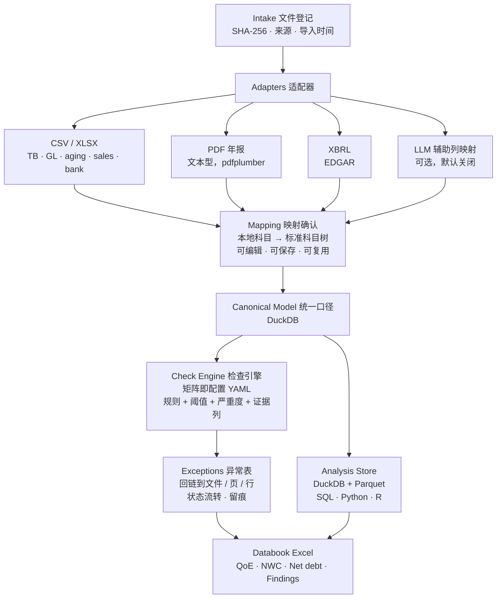

# FDD Workbench · 财务尽调分析工作台

**Status: design stage. Architecture, canonical model and check matrix are defined below. No code is implemented yet.**

> Import a target company's financial files — structured (CSV / XLSX) or unstructured (PDF annual reports) — map them onto one canonical model, run a configurable battery of financial due diligence (FDD) checks, and export a cleaned, query-ready analysis store for SQL, Python and R, plus an Excel databook.

A tool, not a narrative. It does not ship a story about a fake company. It ships adapters, a unified data model, a check engine driven by a matrix, and test fixtures that prove each check fires.

---

## 1. 这是什么

一个面向 **财务尽职调查（Financial Due Diligence, FDD）** 分析师的本地工具。目标公司给你一堆文件——试算表、总账导出、应收账龄、年报 PDF——你把它们丢进来，工具做四件事：

1. **登记与回溯**：每个文件记录哈希、来源、导入时间；之后任何一个数字都能追回到"哪个文件、第几页或第几行"。
2. **统一口径**：把目标公司的本地科目表映射到一套标准 FDD 科目树（Revenue / COGS / Opex / EBITDA 以下 / NWC 项 / Debt-like 项），形成 canonical model。
3. **多维度检查**：按一张可配置的检查矩阵（完整性、报表勾稽、QoE、收入、NWC、净债务、proof of cash、关联方）批量运行分析程序，输出带证据定位的异常清单。
4. **导出可分析库**：DuckDB 单文件 + Parquet，SQL / Python / R 直接读；同时生成 Excel databook（QoE 调整表、NWC 月度、净债务表、findings）。

### 给谁用

- 交易服务 / FDD 团队的分析师（Big4 TS、精品所、买方投后）
- 需要对一家非上市目标公司账套做快速诊断的投资经理
- 作者本人：作为求职作品集，证明"理解 FDD 工作流 + 能把它工程化"

### 不是什么

- 不是行情终端、估值模型或投资组合工具
- 不是审计软件，不出具意见
- 不承诺"任何文件都能自动读懂"。每种格式一个适配器，PDF 提取是 best-effort 并要求人工确认映射
- 不包含编造的"问题公司"数据集。样例数据只是测试用例（见 §9）

---

## 2. 架构



### 分层职责

| 层 | 职责 | 关键约束 |
|---|---|---|
| Intake | 登记文件、计算哈希、记录来源 | 同一哈希不重复导入；原文件只读不改 |
| Adapters | 把一种外部格式解析成"原始行 + 定位信息" | 一种格式一个模块，各自有测试；解析失败降级为"需人工确认"，不猜 |
| Mapping | 本地科目 / 列名 → 标准科目树 | 映射表可编辑、带版本、带审核人；换下一家公司可复用 |
| Canonical | 固定 schema，带约束 | 这是"统计口径统一"的落点；所有检查只读这一层 |
| Check Engine | 读矩阵配置，逐条执行 SQL，写异常 | 规则不写死在代码里；每条检查必须有触发它的 fixture |
| Exceptions | 异常的状态、负责人、备注 | open → investigating → explained / unresolved；不删除，只变更状态 |
| Outputs | DuckDB / Parquet / Excel databook | R 与 Python 通过 DuckDB 或 arrow 直接读，不依赖本工具运行时 |

---

## 3. Canonical Model（统一口径）

所有检查只读这些表。字段以最终 DDL 为准，这里是设计稿。

### 主数据

| 表 | 一行代表 | 关键字段 |
|---|---|---|
| `entity` | 一个被分析的公司 / 法人 | entity_id, name, market, reporting_currency, fiscal_year_end |
| `period` | 一个报告期 | period_id, entity_id, start_date, end_date, grain (month / quarter / year), basis (audited / management / unaudited) |
| `source_file` | 一个导入的文件 | file_id, path, sha256, kind, imported_at, page_count / row_count |
| `std_account` | 标准 FDD 科目树的一个节点 | std_code, name, statement (IS / BS / CF), class (revenue, cogs, opex, da, interest, tax, nwc_ar, nwc_inventory, nwc_ap, nwc_other, cash, debt, debt_like, equity, other), normal_sign |
| `coa_local` | 目标公司本地科目表的一个科目 | entity_id, local_code, local_name |
| `coa_map` | 一条本地科目 → 标准科目的映射 | entity_id, local_code, std_code, mapping_version, reviewer, reviewed_at |
| `counterparty` | 一个客户 / 供应商 / 其他往来方 | counterparty_id, name, type, related_party_flag, evidence_ref |

### 事实表

| 表 | 一行代表 | 关键字段 |
|---|---|---|
| `trial_balance` | 某期某本地科目的余额 | entity_id, period_id, local_code, opening, debit, credit, closing, file_id, row_no |
| `gl_entry` | 一条总账分录行 | entity_id, voucher_no, entry_date, posting_date, local_code, debit, credit, counterparty_id, description, file_id, row_no |
| `statement_line` | 报表（含附注）上的一个数字 | entity_id, period_id, statement, raw_label, std_code (nullable), amount, file_id, page_no, extraction_confidence |
| `ar_aging` / `ap_aging` | 某时点某往来方某账龄桶的余额 | entity_id, as_of, counterparty_id, bucket, amount, file_id, row_no |
| `sales_line` | 一张发票 / 一条销售明细 | entity_id, invoice_no, invoice_date, customer_id, product, quantity, amount, is_credit_note, file_id, row_no |
| `bank_entry` | 一条银行流水 | entity_id, bank_account, booking_date, amount, reference, description, file_id, row_no |

### 运行与结果

| 表 | 一行代表 |
|---|---|
| `check_run` | 一次检查引擎运行（时间、配置哈希、涉及期间） |
| `exception` | 一条异常：check_id, entity_id, period_id, severity, amount, evidence (file_id + page_no / row_no), status, owner, note |

设计原则：
- 所有金额保留原币种和原精度；折算在输出层做，不在事实表做。
- 事实表只追加，不更新；重新导入同一文件被哈希拦截。
- `statement_line` 允许 `std_code` 为空，表示"提取到了但还没映射"，这些行不参与检查，但会出现在待确认清单。

---

## 4. 检查矩阵（Check Matrix）

矩阵是配置文件，不是代码。每条检查的结构：

```yaml
- id: INT-001
  dimension: integrity
  name: Trial balance is balanced
  hypothesis: 借贷不平衡说明导出不完整或被手工调整过
  procedure: 每期 sum(debit) - sum(credit) 应为 0
  sql: checks/sql/int_001_tb_balanced.sql
  threshold: { abs_diff_gt: 0.01 }
  grain: [entity, period]
  severity: high
  evidence_columns: [period_id, diff, file_id]
  required_tables: [trial_balance]
```

### 维度与示例

| 维度 | 示例检查 | 输入层级 |
|---|---|---|
| **Integrity 完整性** | TB 借贷平衡；GL 按科目汇总 = TB；期间连续无缺月；重复凭证号；上期期末 = 本期期初 | TB / GL |
| **Tie-out 报表勾稽** | 资产 = 负债 + 权益；现金流量表净变动 = BS 现金变动；附注合计 = 主表；跨年比较数被重述 | 报表级（PDF / XBRL 也能跑） |
| **QoE 盈利质量** | 一次性项目（关键词 + 金额离群）；关联方交易金额与占比；股东相关费用；会计政策变更 | GL / 附注 |
| **Revenue 收入** | 客户集中度（前 5 / 前 10）；期末 5 日收入占当月比例；期后 credit note 占期末应收比例；价格 / 量拆分 | 销售明细 |
| **NWC 营运资金** | NWC 月度趋势与季节性；DSO / DIO / DPO；账龄恶化 vs 坏账准备率 | TB + aging |
| **Net debt 净债务** | 借款、租赁负债、未付奖金、未缴税、应付股利、预计负债等 debt-like 项识别 | TB + GL + 附注 |
| **Proof of cash** | 账面收款 vs 银行入账；账面付款 vs 银行出账 | GL + bank |
| **Related party 关联方** | 往来方名称 / 地址 / 账号与股东、董事、关联公司匹配 | counterparty + 外部名单 |

完整矩阵（含阈值与证据列）在 `docs/check-matrix.md`，随实现同步更新。

---

## 5. 数据来源与许可政策

**原则：公开披露可以入库并给出来源链接；付费平台数据只在本地用于核对，永远不进仓库。**

### 公开披露（可入 `tests/fixtures/public/`，附 `SOURCES.md`）

| 市场 | 来源 | 用途 |
|---|---|---|
| A 股（沪深） | 巨潮资讯网 cninfo.com.cn（官方披露平台）；上交所 / 深交所官网 | 年报 / 季报 PDF，测 PDF 适配器与勾稽检查 |
| 港股 | HKEXnews hkexnews.hk | 年报 PDF（中英双语） |
| 在美上市中概股 | SEC EDGAR（sec.gov），XBRL Financial Statement Data Sets | 结构化报表，用于验证 PDF 提取结果 |

选公司的标准：
- 同一家公司连续 3–5 个年度，文本型 PDF（非扫描件）
- 至少一家有前期重述或非标审计意见，用于测"跨年数字被改"
- 至少一家有明显季节性（零售、农业），用于测 NWC 趋势

### 仅本地（`data/private/`，已 gitignore）

| 来源 | 用途 | 限制 |
|---|---|---|
| S&P Capital IQ | Key Developments 筛选（重述、审计师变更、非标意见）；标准化三张表导出用于核对 | 许可禁止再分发，不入库，不截图入 README |
| AkShare（Python 库） | 拉 A 股财报结构化数据，核对 PDF 提取 | 数据来自第三方站点，仅作本地验证 |
| 国家统计局 / 人民银行 / 香港政府统计处 API | 行业与宏观基准（后期） | 低优先级 |

### 账套级数据（GL、TB、账龄、销售明细、银行流水）

没有任何公开平台提供真实公司的账套级数据。这一层只用小型 fixtures（见 §9），每份文件明确标注 `SIMULATED`，规模以"能触发对应检查"为限，不构造商业叙事。

---

## 6. 仓库结构（目标）

```
fdd-workbench/
  README.md
  pyproject.toml
  src/fdd_workbench/
    intake/          # 文件登记、哈希
    adapters/        # csv_xlsx.py · pdf_statement.py · xbrl.py · llm_mapping.py (optional)
    mapping/         # 标准科目树、映射规则、人工确认
    model/           # canonical DDL + loaders
    checks/          # 引擎：读 YAML，执行 SQL，写 exception
    outputs/         # duckdb / parquet 导出，databook 生成
    cli.py           # fddw ingest | map | check | export | databook
  taxonomy/          # std_accounts.csv · 关键词规则
  checks/
    matrix.yaml      # 检查矩阵
    sql/             # 每条检查一个 SQL 文件
  tests/
    fixtures/
      simulated/     # 小型 SIMULATED CSV，每份对应一两条检查
      public/        # 真实公开年报 PDF + SOURCES.md
    test_adapters.py
    test_checks.py
  examples/
    python/query.py
    r/read_store.R
  data/
    private/         # gitignored：CapIQ 导出、AkShare 缓存
  docs/
    architecture.md
    check-matrix.md
    data-policy.md
```

---

## 7. 技术栈

| 用途 | 选择 | 理由 |
|---|---|---|
| 语言 | Python 3.11+ | FDD 相关生态（pdf 提取、表格、Excel 生成、统计）全在这里 |
| 分析库 | DuckDB | 单文件、零部署、Python 与 R 都有原生客户端、直接读 Parquet；可随仓库分发 |
| 数据处理 | polars 或 pandas | 待定，优先 polars |
| PDF | pdfplumber | 文本型 PDF 的表格与文字提取；扫描件不支持 |
| Excel 输出 | openpyxl | 生成 databook；替代传统 VBA 自动化 |
| 配置 / 校验 | pydantic + YAML | 矩阵与映射表的结构校验 |
| CLI | typer | |
| 测试 | pytest | 每条检查至少一个触发 fixture |
| R 消费端 | DBI + duckdb，或 arrow 读 Parquet | 示例脚本在 `examples/r/` |

不采用：VBA（用 openpyxl 替代）；ChatGPT Sites 或任何托管前端；LLM 作为核心路径（只做可选插件，默认关闭，密钥只在服务端 / 环境变量）。

---

## 8. 路线图

| 版本 | 范围 | 验收标准 |
|---|---|---|
| **v0.1** | CSV / XLSX 导入 TB + GL → 映射确认 → canonical (DuckDB) → Integrity + QoE 共 8 条检查 → 异常表 | 换一家公司的 TB / GL 进来，同一套检查能跑；每条检查有 fixture 触发 |
| **v0.2** | Databook 输出（QoE 调整表、NWC 月度、净债务表、findings）；Parquet 导出；R 读取示例 | 一条命令出 databook；R 脚本能读到同一份异常表 |
| **v0.3** | PDF 适配器（A 股 / 港股年报）+ Tie-out 检查；用 AkShare / CapIQ 本地核对提取准确率 | 2–3 份真实年报提取后勾稽通过，错误能定位到页 |
| **v0.4** | 可选 LLM 辅助列映射；XBRL（EDGAR）；宏观 / 行业基准 | 锦上添花，不阻塞前三版 |

v0.1 + v0.2 即为完整、可演示的作品集。

---

## 9. 测试与 fixtures 政策

- **Fixture = 已知答案的考题**，不是数据集，不是故事。
- 每条检查至少对应一个会触发它的 fixture 和一个不会触发的 fixture。
- 模拟 fixture 放 `tests/fixtures/simulated/`，文件名含 `SIMULATED`，规模尽量小（十几行到几百行）。
- 真实公开年报放 `tests/fixtures/public/`，`SOURCES.md` 记录来源 URL、公司、年度、下载日期。
- 付费平台数据不得出现在任何测试中。

示例：

```
tests/fixtures/simulated/
  tb_balanced_SIMULATED.csv          # 全部检查应为绿
  tb_unbalanced_SIMULATED.csv        # 触发 INT-001
  gl_missing_month_SIMULATED.csv     # 触发 INT-003 期间不连续
  gl_duplicate_voucher_SIMULATED.csv # 触发 INT-004
  gl_period_end_spike_SIMULATED.csv  # 触发 REV-002 期末突击
```

---

## 10. 与 seller-payout-desk 的关系

本项目是独立仓库，但沿用了 `seller-payout-desk` 验证过的几个模式：

| 沿用 | 来源 |
|---|---|
| 导入器的表头别名、分隔符容错、结果回链到源文件行号 | `dist/import-core.mjs` |
| "可执行断言"作为检查的写法 | `sql/04_checks.sql` |
| 异常队列 + 状态流转 + 留痕 | workspace 异常列表 |
| 规则 → 检查方式 → 证据位置 → 责任人 的矩阵思维 | 内控矩阵设计 |
| 银行 vs 账面的精确匹配逻辑 | `sql/03_reconcile.sql`，改造为 proof of cash |

业务域不同：前者是商家侧打款到账核验，本项目是买方视角的目标公司账套诊断。

---

## 11. 当前限制（设计阶段即明确）

- 扫描件 PDF 不支持；需要 OCR 的文件会被登记但标记为"无法提取"。
- 不做多币种折算；折算放在输出层由用户指定汇率表。
- 不做合并抵销；多法人的合并留给后续版本。
- 检查结果是"需要解释的异常"，不是结论；是否构成 QoE 调整由分析师判断并在 `exception.status` 记录。
- LLM 辅助映射即使启用，其建议也必须经人工确认后才写入 `coa_map`。
