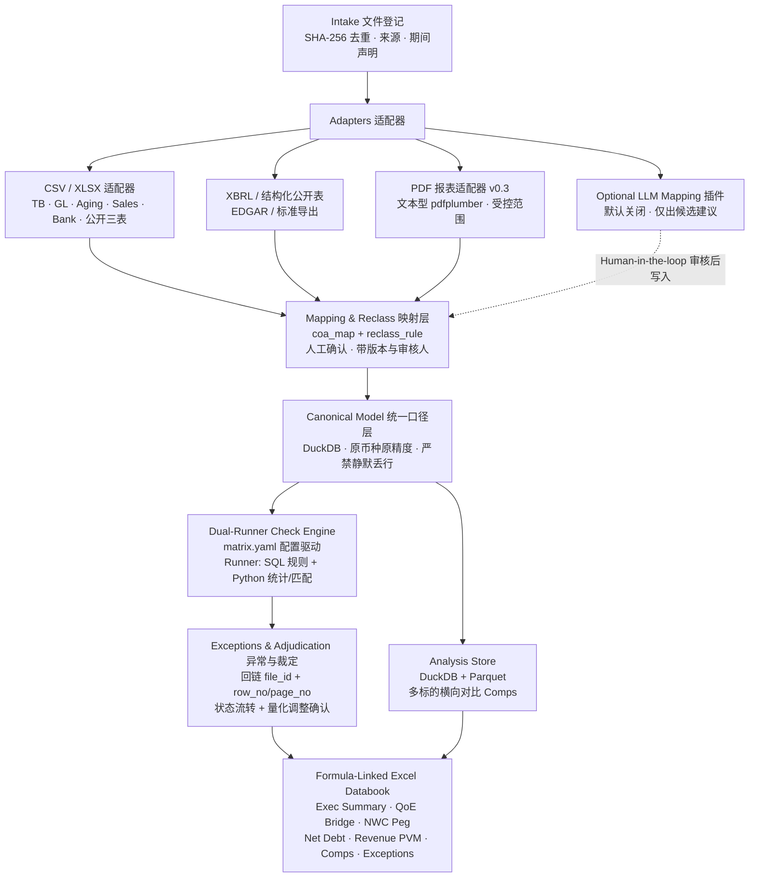

# FDD Workbench · 买方投资尽调与估值前置工作台 (v2 Design & Engineering Spec)

> **Status: v2.0 工程大纲（Engineering Specification for Codex Execution）**
> 本文件基于 [README.md](README.md) 演进，在不修改原设计稿的前提下，补齐**“投资分析前台决策闭环（Valuation & Deal Bridges）”**、**“多标的横向可比”**、**“财务建模细节修复”**与**“可直接交付给 Codex 实施的工程规范”**。

> Import a target company's financial files (CSV / XLSX / public structured filings) — normalize them onto a single auditable canonical model in DuckDB, run a dual-runner (`SQL` + `Python`) due diligence check matrix, adjudicate findings into deal adjustments, and export both a query-ready Parquet/DuckDB store and a formula-linked Excel Databook (`QoE Bridge` / `NWC Peg` / `Net Debt` / `Revenue PVM` / `Comps`).

**一句话定位**：面向买方投资分析前台（战略投资 / M&A / PE / 综合集团投资部）与交易尽调团队的**本地尽调数据底座与估值前置工作台**——把异构非标财务数据洗成可回溯的统一口径，自动排查盈利质量、营运资金与类债务隐患，并直接算出对 **Adjusted EBITDA、NWC Peg、Net Debt 与估值桥梁** 的量化影响。

---

## 1. 这是什么 / 给谁用 / 不是什么

### 解决的核心问题
投资分析前台看一个标的公司时，通常面临三个断层：
1. **数据非标且无法溯源**：目标公司发来的试算表（TB）、总账（GL）、应收账龄、销售明细、银行流水格式各异，手工整理进 Excel 后，上会（IC）时一旦被追问“这笔调整哪来的”，往往找不到原始文件和行号。
2. **只做“审计找错”，没有“定价桥梁”**：传统 FDD 止步于列出异常清单；前台投资经理真正要回答的是：**“这些异常如果成立，会拉低多少 Adjusted EBITDA？NWC Peg 应该设多少？有多少隐性类债务（Debt-like）要从 EV 里扣掉？”**
3. **前期筛选与深水区尽调割裂**：签 NDA 前只有公开披露三表 / 可比公司数据，进 VDR 后才有 TB / GL；两套工具不互通，前期基准无法延续到后期尽调。

### 给谁用
- **大厂战略投资 / 产业投资 / 买方投资前台分析师**：快速完成标的商业与财务体检、同业横向对标（Cross-Entity Benchmarking），输出可进 IC Deck 和估值模型的底稿。
- **交易服务 / FDD 分析师与投后团队**：标准化账套清洗、证据链留痕、异常状态流转与复核。

### 不是什么（明确边界）
- **不是**全功能估值模型（DCF / LBO / 三表预测模型）或二级市场行情终端；本工具为估值模型提供**经过清洗和验证的干净输入（Adjusted EBITDA、NWC Peg、Net Debt、PVM 拆解）**。
- **不是**法定审计软件，不出具审计意见。
- **不是**“AI 一键读财报生成投资结论”的黑盒工具。**确定性计算放内核，概率性 AI 放边缘且必须 Human-in-the-loop**——不承诺任何脏 PDF 都能全自动无误提取。
- **不包含**虚构商业故事数据集；所有测试仅使用精确标注 `SIMULATED` 的规则触发 Fixture 与合规公开披露数据。

---

## 2. 系统架构与人机边界



### 分层职责与关键约束

| 层 | 职责 | 硬性约束 |
|---|---|---|
| **Intake** | 登记文件元数据、计算 SHA-256、记录导入上下文 | 同哈希禁止重复导入；原始文件严格只读不改 |
| **Adapters** | 异构格式解析为标准中间行 + 精确定位信息 | 一格式一模块；支持表头别名、千分位、括号负数、BOM/编码容错；解析失败明确报错或降级为待确认，**绝不静默丢弃** |
| **Mapping & Reclass** | 本地科目/表项 $\rightarrow$ 标准科目树 + 条件重分类 | 映射必须显式版本化、可复用；未映射项进入待确认队列，不参与自动计算假象 |
| **Canonical** | 统一 Schema、精确数值类型、统一符号与口径 | 所有金额采用 `DECIMAL(18, 4)`；原币种原精度入库；所有下游只读这一层 |
| **Check Engine** | 读 `checks/matrix.yaml`，调度 `sql` 或 `python` runner | 规则配置化；每条检查绑定 `deal_impact` 类别与正反测试用例 |
| **Adjudication** | 分析师对异常进行状态流转与调整金额确认 | 异常只追加事件或变更状态，不物理删除；只有 `confirmed_*` 状态进入 Bridge 汇总 |
| **Outputs** | 导出 DuckDB/Parquet 与多 Tab Excel Databook | Excel **优先写入动态公式**（`SUMIFS` 等）与清晰底稿格式，不写入无依据死数 |

### 确定性内核 vs. 边缘 AI 原则
- **内核 100% 确定性**：入库、映射应用、检查引擎、Bridge 汇总全部为可复现、可单元测试的 SQL/Python 代码。
- **AI 仅作为可选边缘插件**：`llm_mapping.py` 默认关闭；开启时仅用于对未知本地科目名称/表头给出推荐映射，**必须由分析师人工确认并记录 `reviewer` 后才写入 `coa_map`**。涉密非上市账套项目可在完全离线环境下运行全部核心流程。

---

## 3. Canonical Model（统一口径与 Schema 规范）

### 3.1 必须守住的 5 条财务建模规则（修复原设计隐患）

1. **损益类科目期末结转规则（中国用友/金蝶等 TB 适配）**
   - 国内财务软件年结/月结后，损益类科目（Revenue / COGS / Opex）的期末余额 `closing` 常为 `0`（已结转至本年利润）。
   - `trial_balance` 必须区分资产负债与损益类取数：`bs` 类取 `closing`；`is` 类默认优先取 `ytd_debit` / `ytd_credit`（或 `period_debit` / `period_credit` / `is_pre_closing = true` 时的发生额），防止收入/费用在年末汇总归零。
2. **口径隔离（Grain / Basis / Consolidation Scope 防重算）**
   - 同一家公司可能同时导入月度管理层报表（`month` + `management`）和年度审计报表（`year` + `audited`），或合并报表（`consolidated`）与母公司单体报表（`standalone`）。
   - `period` 表强制包含 `grain`、`basis`、`consolidation_scope` 三个维度；Check Engine 与 Bridge 视图必须显式锁定口径（默认优先级：`audited > unaudited > management`，且严禁跨 `grain` 或跨 `scope` 直接 `SUM`）。
3. **一对多科目重分类（`coa_map` + `reclass_rule`）**
   - 实务中“其他应付款”“管理费用-其他”极少能 1-to-1 映射（例如同一科目内既有营运押金[NWC]，又有股东借款[Debt-like]）。
   - 在科目级静态映射 `coa_map` 之外，增加规则级重分类 `reclass_rule`（可按 `counterparty`、`description` 关键词或 `voucher_no` 在 GL/Aging 层面做更高优先级的归类覆盖）。
4. **凭证内对手科目分析能力（`gl_entry`）**
   - `gl_entry` 强制保留 `voucher_line_no`（同张凭证内行序号），支持按 `(entity_id, period_id, voucher_no)` 联合查询**对方科目分布**（例如检查贷记“主营业务收入”时，借方对应的是正常现金/应收，还是异常的长期挂账往来）。
   - 同时保留 `raw_counterparty` 原始文本，避免因原始导出的往来辅助核算列缺失而丢失信息。
5. **异常裁定与估值桥梁打通（`exception` $\rightarrow$ Deal Impact）**
   - 异常表不再只是“问题列表”，而是直接支撑交易定价调整：每条 `exception` 携带 `deal_impact_type`（`qoe_ebitda` | `nwc_peg` | `net_debt` | `integrity_blocker` | `info_only`），分析师确认后填入 `confirmed_adj_amount` 与 `recurring_flag`，Databook 的三大 Bridge 表直接据此动态出数。

### 3.2 核心表结构（DuckDB DDL 规范）

Codex 实现时请直接以此 Schema 为基础编写 `src/fdd_workbench/model/schema.sql`：

```sql
-- 1. 主数据：被分析标的与可比公司
CREATE TABLE IF NOT EXISTS entity (
    entity_id VARCHAR PRIMARY KEY,
    name VARCHAR NOT NULL,
    role VARCHAR NOT NULL DEFAULT 'target', -- 'target' | 'comp'
    market VARCHAR,                         -- 'CN_PRIVATE' | 'A_SHARE' | 'HKEX' | 'US_SEC'
    reporting_currency VARCHAR(10) NOT NULL DEFAULT 'CNY',
    fiscal_year_end VARCHAR(5) NOT NULL DEFAULT '12-31',
    created_at TIMESTAMP DEFAULT CURRENT_TIMESTAMP
);

-- 2. 主数据：报告期与口径边界
CREATE TABLE IF NOT EXISTS period (
    period_id VARCHAR PRIMARY KEY,          -- e.g. 'ENT01_2025M12_MGMT_CONS'
    entity_id VARCHAR NOT NULL REFERENCES entity(entity_id),
    start_date DATE NOT NULL,
    end_date DATE NOT NULL,
    grain VARCHAR NOT NULL,                 -- 'month' | 'quarter' | 'year'
    basis VARCHAR NOT NULL,                 -- 'audited' | 'management' | 'unaudited'
    consolidation_scope VARCHAR NOT NULL DEFAULT 'consolidated', -- 'consolidated' | 'standalone'
    UNIQUE (entity_id, start_date, end_date, grain, basis, consolidation_scope)
);

-- 3. 主数据：源文件登记与不可变哈希
CREATE TABLE IF NOT EXISTS source_file (
    file_id VARCHAR PRIMARY KEY,
    entity_id VARCHAR NOT NULL REFERENCES entity(entity_id),
    path VARCHAR NOT NULL,
    sha256 VARCHAR(64) NOT NULL UNIQUE,
    kind VARCHAR NOT NULL,                  -- 'tb' | 'gl' | 'ar_aging' | 'ap_aging' | 'sales' | 'bank' | 'statement'
    imported_at TIMESTAMP DEFAULT CURRENT_TIMESTAMP,
    row_count INTEGER,
    page_count INTEGER,
    notes VARCHAR
);

-- 4. 标准科目树（FDD + 前台分析通用口径）
CREATE TABLE IF NOT EXISTS std_account (
    std_code VARCHAR PRIMARY KEY,
    name VARCHAR NOT NULL,
    name_zh VARCHAR,
    statement VARCHAR NOT NULL,             -- 'IS' | 'BS' | 'CF'
    category VARCHAR NOT NULL,              -- 'revenue' | 'cogs' | 'opex_sm' | 'opex_ga' | 'opex_rd' | 'da' | 'interest' | 'tax' | 'non_op' | 'nwc_ar' | 'nwc_inventory' | 'nwc_ap' | 'nwc_other' | 'cash' | 'debt' | 'debt_like' | 'equity' | 'other'
    normal_sign INTEGER NOT NULL,           -- 1 (debit-normal: asset/expense) | -1 (credit-normal: liability/equity/revenue)
    is_ebitda_component BOOLEAN NOT NULL DEFAULT FALSE,
    is_nwc_component BOOLEAN NOT NULL DEFAULT FALSE,
    is_net_debt_component BOOLEAN NOT NULL DEFAULT FALSE
);

-- 5. 本地科目表与科目级映射
CREATE TABLE IF NOT EXISTS coa_local (
    entity_id VARCHAR NOT NULL REFERENCES entity(entity_id),
    local_code VARCHAR NOT NULL,
    local_name VARCHAR NOT NULL,
    PRIMARY KEY (entity_id, local_code)
);

CREATE TABLE IF NOT EXISTS coa_map (
    map_id VARCHAR PRIMARY KEY,
    entity_id VARCHAR NOT NULL,
    local_code VARCHAR NOT NULL,
    std_code VARCHAR NOT NULL REFERENCES std_account(std_code),
    mapping_version INTEGER NOT NULL DEFAULT 1,
    source VARCHAR NOT NULL DEFAULT 'manual', -- 'manual' | 'rule' | 'llm_confirmed'
    reviewer VARCHAR NOT NULL,
    reviewed_at TIMESTAMP NOT NULL DEFAULT CURRENT_TIMESTAMP,
    FOREIGN KEY (entity_id, local_code) REFERENCES coa_local(entity_id, local_code),
    UNIQUE (entity_id, local_code, mapping_version)
);

-- 6. 条件重分类规则（优先级高于科目级映射，解决一对多拆账）
CREATE TABLE IF NOT EXISTS reclass_rule (
    rule_id VARCHAR PRIMARY KEY,
    entity_id VARCHAR NOT NULL REFERENCES entity(entity_id),
    priority INTEGER NOT NULL DEFAULT 100,  -- 数字越小优先级越高
    target_table VARCHAR NOT NULL,          -- 'gl_entry' | 'trial_balance' | 'ar_aging' | 'ap_aging'
    match_local_code VARCHAR,
    match_counterparty_regex VARCHAR,
    match_description_regex VARCHAR,
    override_std_code VARCHAR NOT NULL REFERENCES std_account(std_code),
    reason VARCHAR NOT NULL,
    reviewer VARCHAR NOT NULL,
    active BOOLEAN NOT NULL DEFAULT TRUE
);

-- 7. 往来方主数据
CREATE TABLE IF NOT EXISTS counterparty (
    counterparty_id VARCHAR PRIMARY KEY,
    entity_id VARCHAR NOT NULL REFERENCES entity(entity_id),
    name VARCHAR NOT NULL,
    party_type VARCHAR NOT NULL DEFAULT 'unknown', -- 'customer' | 'supplier' | 'employee' | 'shareholder' | 'bank' | 'other' | 'unknown'
    related_party_flag BOOLEAN NOT NULL DEFAULT FALSE,
    evidence_ref VARCHAR
);

-- 8. 事实表：试算平衡表（Trial Balance）
CREATE TABLE IF NOT EXISTS trial_balance (
    tb_id VARCHAR PRIMARY KEY,
    entity_id VARCHAR NOT NULL REFERENCES entity(entity_id),
    period_id VARCHAR NOT NULL REFERENCES period(period_id),
    local_code VARCHAR NOT NULL,
    opening DECIMAL(18, 4) NOT NULL DEFAULT 0,       -- 有符号：借正贷负
    debit DECIMAL(18, 4) NOT NULL DEFAULT 0,         -- 本期借方发生额 (>=0)
    credit DECIMAL(18, 4) NOT NULL DEFAULT 0,        -- 本期贷方发生额 (>=0)
    closing DECIMAL(18, 4) NOT NULL DEFAULT 0,       -- 有符号：借正贷负
    ytd_debit DECIMAL(18, 4),                        -- 本年累计借方（防止期末损益结转归零）
    ytd_credit DECIMAL(18, 4),                       -- 本年累计贷方
    is_pre_closing BOOLEAN NOT NULL DEFAULT TRUE,
    raw_currency VARCHAR(10) NOT NULL DEFAULT 'CNY',
    file_id VARCHAR NOT NULL REFERENCES source_file(file_id),
    row_no INTEGER NOT NULL
);

-- 9. 事实表：总账分录（GL Entry）
CREATE TABLE IF NOT EXISTS gl_entry (
    gl_id VARCHAR PRIMARY KEY,
    entity_id VARCHAR NOT NULL REFERENCES entity(entity_id),
    period_id VARCHAR NOT NULL REFERENCES period(period_id),
    voucher_no VARCHAR NOT NULL,
    voucher_line_no INTEGER NOT NULL,
    entry_date DATE,
    posting_date DATE NOT NULL,
    local_code VARCHAR NOT NULL,
    debit DECIMAL(18, 4) NOT NULL DEFAULT 0,
    credit DECIMAL(18, 4) NOT NULL DEFAULT 0,
    counterparty_id VARCHAR REFERENCES counterparty(counterparty_id),
    raw_counterparty VARCHAR,
    description VARCHAR,
    raw_currency VARCHAR(10) NOT NULL DEFAULT 'CNY',
    file_id VARCHAR NOT NULL REFERENCES source_file(file_id),
    row_no INTEGER NOT NULL
);

-- 10. 事实表：标准化/提取报表行（公开披露 & Comps 主入口）
CREATE TABLE IF NOT EXISTS statement_line (
    stmt_line_id VARCHAR PRIMARY KEY,
    entity_id VARCHAR NOT NULL REFERENCES entity(entity_id),
    period_id VARCHAR NOT NULL REFERENCES period(period_id),
    statement VARCHAR NOT NULL,             -- 'IS' | 'BS' | 'CF' | 'NOTE'
    raw_label VARCHAR NOT NULL,
    std_code VARCHAR REFERENCES std_account(std_code), -- NULL 表示已入库待映射
    amount DECIMAL(18, 4) NOT NULL,
    raw_currency VARCHAR(10) NOT NULL DEFAULT 'CNY',
    extraction_confidence DECIMAL(5, 4) DEFAULT 1.0,
    file_id VARCHAR NOT NULL REFERENCES source_file(file_id),
    page_no INTEGER,
    row_no INTEGER
);

-- 11. 事实表：应收/应付账龄（合并模型用 party_kind 区分或分两表，这里显式用 ledger_side 避免重复结构）
CREATE TABLE IF NOT EXISTS aging_balance (
    aging_id VARCHAR PRIMARY KEY,
    entity_id VARCHAR NOT NULL REFERENCES entity(entity_id),
    period_id VARCHAR NOT NULL REFERENCES period(period_id),
    ledger_side VARCHAR NOT NULL,           -- 'AR' | 'AP'
    as_of DATE NOT NULL,
    counterparty_id VARCHAR REFERENCES counterparty(counterparty_id),
    raw_counterparty VARCHAR NOT NULL,
    bucket VARCHAR NOT NULL,                -- '0-30d' | '31-90d' | '91-180d' | '181-365d' | '>365d'
    amount DECIMAL(18, 4) NOT NULL,
    provision_amount DECIMAL(18, 4) DEFAULT 0,
    raw_currency VARCHAR(10) NOT NULL DEFAULT 'CNY',
    file_id VARCHAR NOT NULL REFERENCES source_file(file_id),
    row_no INTEGER NOT NULL
);

-- 12. 事实表：销售发票/订单明细（用于收入质量检查 + 商业 PVM & Cohort 分析）
CREATE TABLE IF NOT EXISTS sales_line (
    sales_id VARCHAR PRIMARY KEY,
    entity_id VARCHAR NOT NULL REFERENCES entity(entity_id),
    period_id VARCHAR REFERENCES period(period_id),
    invoice_no VARCHAR NOT NULL,
    invoice_date DATE NOT NULL,
    customer_id VARCHAR REFERENCES counterparty(counterparty_id),
    raw_customer VARCHAR NOT NULL,
    product VARCHAR NOT NULL,
    quantity DECIMAL(18, 4) NOT NULL,
    unit_price DECIMAL(18, 4),
    amount DECIMAL(18, 4) NOT NULL,         -- 净不含税收入额（退货/折让为负）
    gross_margin_amount DECIMAL(18, 4),     -- 可选：用于客户毛利贡献分析
    is_credit_note BOOLEAN NOT NULL DEFAULT FALSE,
    raw_currency VARCHAR(10) NOT NULL DEFAULT 'CNY',
    file_id VARCHAR NOT NULL REFERENCES source_file(file_id),
    row_no INTEGER NOT NULL
);

-- 13. 事实表：银行流水
CREATE TABLE IF NOT EXISTS bank_entry (
    bank_entry_id VARCHAR PRIMARY KEY,
    entity_id VARCHAR NOT NULL REFERENCES entity(entity_id),
    bank_account VARCHAR NOT NULL,
    booking_date DATE NOT NULL,
    amount DECIMAL(18, 4) NOT NULL,         -- 入账为正，出账为负
    reference VARCHAR,
    counterparty_name VARCHAR,
    description VARCHAR,
    raw_currency VARCHAR(10) NOT NULL DEFAULT 'CNY',
    file_id VARCHAR NOT NULL REFERENCES source_file(file_id),
    row_no INTEGER NOT NULL
);

-- 14. 运行记录与异常裁定表（串联 FDD 发现 -> 估值调整）
CREATE TABLE IF NOT EXISTS check_run (
    run_id VARCHAR PRIMARY KEY,
    entity_id VARCHAR NOT NULL REFERENCES entity(entity_id),
    started_at TIMESTAMP DEFAULT CURRENT_TIMESTAMP,
    matrix_sha256 VARCHAR(64) NOT NULL,
    target_basis VARCHAR NOT NULL,
    target_scope VARCHAR NOT NULL,
    status VARCHAR NOT NULL                 -- 'completed' | 'failed'
);

CREATE TABLE IF NOT EXISTS exception (
    exception_id VARCHAR PRIMARY KEY,
    run_id VARCHAR NOT NULL REFERENCES check_run(run_id),
    check_id VARCHAR NOT NULL,
    entity_id VARCHAR NOT NULL REFERENCES entity(entity_id),
    period_id VARCHAR REFERENCES period(period_id),
    dimension VARCHAR NOT NULL,
    severity VARCHAR NOT NULL,              -- 'high' | 'medium' | 'low'
    deal_impact_type VARCHAR NOT NULL,      -- 'qoe_ebitda' | 'nwc_peg' | 'net_debt' | 'integrity_blocker' | 'commercial_quality'
    raw_flagged_amount DECIMAL(18, 4),
    summary VARCHAR NOT NULL,
    evidence_json VARCHAR NOT NULL,         -- JSON: [{file_id, row_no, page_no, ref}]
    status VARCHAR NOT NULL DEFAULT 'open', -- 'open' | 'investigating' | 'explained' | 'confirmed_adj' | 'unresolved'
    confirmed_adj_amount DECIMAL(18, 4) DEFAULT 0, -- 分析师确认进入 Bridge 的有符号调整额（如 -1500000 代表调减 EBITDA）
    recurring_flag BOOLEAN,
    owner VARCHAR,
    note VARCHAR,
    updated_at TIMESTAMP DEFAULT CURRENT_TIMESTAMP
);
```

---

## 4. Check Engine 与检查矩阵规范

### 4.1 矩阵配置格式（`checks/matrix.yaml`）

支持 `runner: sql`（结构化汇总/平衡/勾稽）和 `runner: python`（统计离群值、文本关键词、模糊匹配、多笔拆单匹配）：

```yaml
- id: INT-001
  dimension: integrity
  runner: sql
  name: Trial balance is balanced by period
  hypothesis: 本期借贷不平衡说明账套导出不完整、或存在单边手工调账
  procedure: 按 (entity_id, period_id) 汇总 sum(debit) - sum(credit) 与 sum(closing)
  entry: checks/sql/int_001_tb_balanced.sql
  threshold: { abs_diff_gt: 0.01 }
  grain: [month, quarter, year]
  severity: high
  deal_impact_type: integrity_blocker
  required_tables: [trial_balance]
  evidence_columns: [period_id, diff_flow, diff_closing, file_id, min_row_no]
```

### 4.2 核心检查矩阵（v0.1–v0.3 实现清单）

| Check ID | 维度 | Runner | 检查内容与逻辑 | 前台交易影响（Deal Impact） | 阶段 |
|---|---|---|---|---|---|
| `INT-001` | Integrity | `sql` | TB 借贷平衡与期末借贷净额平衡（`abs(sum) > 0.01`） | `integrity_blocker`（基础可信度红线） | **v0.1** |
| `INT-002` | Integrity | `sql` | GL 按 `(period, local_code)` 汇总与 TB 发生额一致性 | `integrity_blocker` | **v0.1** |
| `INT-003` | Integrity | `sql` | 期间连续性无缺月 + 跨期 `上期 closing == 本期 opening` | `integrity_blocker` | **v0.1** |
| `INT-004` | Integrity | `sql` | 重复凭证号或同凭证内未平衡分录检查 | `integrity_blocker` | **v0.1** |
| `INT-005` | Integrity | `sql` | 存在已导入但未映射到 `std_account` 的金额（防止静默漏数） | `integrity_blocker` | **v0.1** |
| `QOE-001` | QoE | `python` | 一次性/非经营性损益关键词（政府补助、诉讼赔偿、资产处置、重组等）与大额离群分录（IQR / Z-score） | `qoe_ebitda`（EBITDA 正常化剔除项） | **v0.1** |
| `QOE-002` | QoE | `sql` | 股东/高管个人消费与关联方往来费用识别（按 `party_type` + 对手科目） | `qoe_ebitda` | **v0.1** |
| `QOE-003` | QoE | `sql` | 异常收入凭证对手科目排查（贷记收入但借方非现金/银行/正常应收） | `qoe_ebitda` / `integrity_blocker` | **v0.1** |
| `REV-001` | Revenue | `sql` | 期末最后 5 天收入占当月比例异常突击（Cutoff 风险） | `qoe_ebitda`（跨期收入调减） | **v0.1** |
| `REV-002` | Revenue | `sql` | 期后 30 天内大额红字冲销/退货（Credit Note）占期末应收比例 | `qoe_ebitda` + `nwc_peg` | **v0.2** |
| `REV-003` | Revenue | `python` | **商业增长拆解（PVM）+ Top 5/10 客户集中度 + 年度 Cohort 留存率** | `commercial_quality`（支撑增长假设） | **v0.2** |
| `NWC-001` | NWC | `sql` | 账龄恶化（>180天占比上升）但坏账计提比例反常下降 | `nwc_peg` / `qoe_ebitda`（补提坏账） | **v0.2** |
| `NWC-002` | NWC | `sql` | 月度 NWC 偏离 12 个月均值/季节性离群（识别交割前刻意压货或延迟付款） | `nwc_peg`（直接决定交割 Peg） | **v0.2** |
| `DEBT-001` | Net Debt | `sql` | Debt-like 潜伏项扫描（`reclass_rule` + 长期挂账应付股利、未缴税款、未付年终奖、融资租赁、股东拆借） | `net_debt`（直接从 EV 扣减对价） | **v0.2** |
| `TIE-001` | Tie-out | `sql` | 报表勾稽（资产=负债+权益；现金表净变动=BS 现金变动；跨年比较期重述检查） | `integrity_blocker` | **v0.3** |
| `POC-001` | Proof of Cash | `python` | 账面银行科目收付 vs 银行流水进出逐月/逐笔匹配与未达账队列 | `integrity_blocker` / `net_debt` | **v0.3** |
| `RPT-001` | Related Party | `python` | 往来方名称与外部股东/董监高/关联方名单模糊匹配（Token / 编辑距离） | `qoe_ebitda` / `net_debt` | **v0.3** |

---

## 5. 前台交付物规范：Excel Databook 与 Analysis Store

### 5.1 Excel Databook 输出规范（`openpyxl`，v0.2 核心验收标准）

生成的 `databook_<entity_id>_<timestamp>.xlsx` 必须遵循**投行/买方底稿规范**：
- **动态公式优先**：汇总单元格、QoE Bridge 小计、NWC 均值、EV-to-Equity 调整和 Comps 比率必须使用 Excel 公式（`SUM`、`SUMIFS`、`AVERAGE`、跨表引用），禁止全部硬编码数字。
- **标准颜色编码**：蓝色字体 = 硬输入/原表提取数；黑色字体 = 同表公式；绿色字体 = 跨表链接公式；浅红底色 = High Severity 未决异常警告。
- **7 个标准工作表（Tabs）**：

| Tab 序号与名称 | 核心内容与前台价值 | 数据来源 |
|---|---|---|
| `00_Exec_Summary` | **交易结论一页纸**：Reported vs. Adjusted EBITDA、NWC Peg 建议区间、Net Debt & Debt-like 汇总、High/Medium 异常计数与影响金额 | 跨表公式汇总 |
| `01_QoE_EBITDA_Bridge` | **盈利质量桥梁**：从 Reported Net Income / EBITDA 逐行加减 `confirmed_adj` 状态的 `qoe_ebitda` 异常项，附带 `exception_id` 与原文件定位 | `std_account` + `exception` |
| `02_NWC_Trend_Peg` | **营运资金趋势与 Peg**：过去 12–24 个月 AR / Inventory / AP / Other NWC 月度表、DSO / DIO / DPO、LTM 均值 / 剔除异常后均值与 Peg 建议 | `trial_balance` + `aging_balance` |
| `03_Net_Debt_Bridge` | **净债务与类债务清单**：Cash、Interest-bearing Debt、已确认的 `debt_like` 项明细，汇总为 Net Debt 调减项 | `trial_balance` + `reclass_rule` + `exception` |
| `04_Revenue_PVM_Cohort` | **商业增长质量**：Top 10 客户占比趋势、Price-Volume-Mix 拆分表、客户年度/季度留存 Cohort 矩阵、期末 Cutoff 异常统计 | `sales_line` |
| `05_Comps_Benchmark` | **多标的横向对标**：同一套 `std_account` 口径下，Target 与可比公司的毛利率、三费率、EBITDA Margin、DSO/DIO/DPO 对比 | `statement_line` + `trial_balance` |
| `06_Exceptions_Log` | **全量异常与证据回链台账**：`exception_id`、`check_id`、`severity`、`deal_impact_type`、`status`、`confirmed_adj_amount`、`file_id + row_no/page_no`、`note` | `exception` + `source_file` |

### 5.2 Analysis Store
- 导出标准化单文件 `store.duckdb` 与按表切分的 `exports/parquet/*.parquet`。
- Python 分析师可直接通过 `duckdb.connect("store.duckdb", read_only=True)` 或 `polars.read_parquet()` 做二次切分；不强绑定任何专属前端或运行环境。

---

## 6. CLI 工作流与命令契约（`fddw`）

使用 `typer` 提供清晰、幂等、可脚本化的命令行接口：

```bash
# 1. 初始化项目工作区与 DuckDB 数据库
fddw init --db data/work/project.duckdb

# 2. 注册实体并导入原始文件（自动算 SHA-256，防重复）
fddw entity add --id TARGET_A --name "Alpha Tech" --role target --currency CNY
fddw ingest --entity TARGET_A --kind tb --period 2025M12 --basis management --file raw/tb_2025.xlsx
fddw ingest --entity TARGET_A --kind gl --period 2025M12 --basis management --file raw/gl_2025.csv

# 3. 导出待映射科目清单 / 导入已审核的映射表与重分类规则
fddw map export-unmapped --entity TARGET_A --out work/unmapped_coa.csv
fddw map apply --entity TARGET_A --file work/coa_map_reviewed.csv --reviewer "Analyst_Li"
fddw map apply-reclass --entity TARGET_A --file work/reclass_rules.yaml --reviewer "Analyst_Li"

# 4. 运行检查引擎（读 matrix.yaml，输出异常统计）
fddw check --entity TARGET_A --matrix checks/matrix.yaml --basis management --scope consolidated

# 5. 异常裁定（支持交互确认或批量导入审核后的 exceptions CSV）
fddw adjudicate --entity TARGET_A --file work/exceptions_reviewed.csv

# 6. 导出分析底座与生成 Excel Databook
fddw export --out data/exports/
fddw databook --entity TARGET_A --comps COMP_1,COMP_2 --out data/exports/Alpha_Databook.xlsx

# 7. 一键运行端到端演示包（使用 tests/fixtures/simulated_showcase/）
fddw demo --out /tmp/fddw_demo_out
```

---

## 7. 数据来源、许可边界与演示策略

**合规铁律：公开披露可入库并记录出处；商业付费数据只在本地核对，永远不进 Git 仓库与测试集。**

| 数据层级 | 来源 | 仓库处理方式 | 用途 |
|---|---|---|---|
| **账套级测试 Fixtures** | 自构造最小化 `SIMULATED` CSV/XLSX | 入库 `tests/fixtures/simulated/` | 每条检查至少 1 个触发用例 + 1 个通过用例 |
| **端到端 Showcase 演示包** | 脱敏合成账套 + 公开可比公司三表 | 入库 `examples/showcase/`（显式标注 `SIMULATED`） | 供面试官一条命令 `fddw demo` 直接跑出完整 Databook |
| **公开披露报表（v0.3+）** | 巨潮 `cninfo.com.cn`、HKEXnews、SEC EDGAR (XBRL) | `tests/fixtures/public/` + `SOURCES.md` | 测 Tie-out 检查与 Cross-Entity Comps |
| **付费平台（仅本地）** | S&P Capital IQ / Wind / AkShare 本地缓存 | 放 `data/private/`（`.gitignore` 屏蔽） | 仅本地核对口径与准确性 |

---

## 8. 目标仓库结构（Target Repo Layout）

```text
fdd-workbench/
  README.md                       # 保留 v1 原初设计稿
  README_v2.md                    # 本工程大纲与规范
  pyproject.toml                  # Python 3.11+, ruff, pytest, duckdb, polars, openpyxl, typer, pydantic, pyyaml
  src/
    fdd_workbench/
      __init__.py
      cli.py                      # typer CLI 入口：init / entity / ingest / map / check / adjudicate / export / databook / demo
      config.py                   # 路径、默认阈值、别名字典加载
      intake/
        registry.py               # SHA-256 计算、重复文件拦截、source_file 写入
      adapters/
        base.py                   # 统一解析结果容器 & ParseError（禁止静默丢行）
        csv_xlsx.py               # TB / GL / Aging / Sales / Bank / Statement 适配器（表头别名、中文编码、括号负数）
        xbrl.py                   # v0.3: SEC EDGAR / XBRL 结构化报表
        pdf_statement.py          # v0.3: 文本型 PDF 受控提取
        llm_mapping.py            # v0.4: 可选插件（默认关闭，仅产出候选映射 CSV）
      mapping/
        taxonomy.py               # 加载 taxonomy/std_accounts.csv 并建表
        mapper.py                 # 应用 coa_map + reclass_rule，生成未映射待办清单
      model/
        schema.sql                # 第 3 节完整 DuckDB DDL
        store.py                  # DuckDB 连接管理、事务写入、Canonical 视图（含 Effective Mapped View）
      checks/
        engine.py                 # 读取 matrix.yaml，校验配置，分发 sql / python runner，写 check_run & exception
        sql_runner.py             # 执行 checks/sql/*.sql
        python_runner.py          # 执行 checks/py/*.py（统计离群、PVM、模糊匹配、拆单对账）
        adjudication.py           # 异常状态流转与 confirmed_adj_amount 回写
      analytics/
        bridges.py                # 计算 QoE Bridge、NWC Peg、Net Debt Bridge 数据集
        pvm_cohort.py             # 计算收入 Price-Volume-Mix 拆解与客户 Cohort
        benchmark.py              # 多标的 Cross-Entity Comps 指标矩阵
      outputs/
        parquet_export.py         # 导出 Parquet 与只读 DuckDB 副本
        databook.py               # openpyxl 生成第 5 节 7 个 Tab 的公式化 Excel Databook
  taxonomy/
    std_accounts.csv              # 标准 FDD + 前台分析科目树初始数据
    header_aliases.yaml           # 常见中英文财务导出表头别名映射（用友/金蝶/SAP/NetSuite/QuickBooks）
    qoe_keywords.yaml             # 一次性/非经常性损益及关联方中英文关键词库
  checks/
    matrix.yaml                   # 检查矩阵配置
    sql/                          # int_001_*.sql, qoe_002_*.sql, ...
    py/                           # qoe_001_outliers.py, rev_003_pvm.py, ...
  examples/
    showcase/                     # 端到端一键演示数据包（明确标注 SIMULATED）与预期 Databook 示例
    python/query_store.py         # 用 DuckDB / Polars 读取 Analysis Store 示例
  tests/
    conftest.py
    fixtures/
      simulated/                  # 每条规则至少正/反一对极简 CSV
      public/                     # 公开年报或 XBRL + SOURCES.md
    test_intake_and_adapters.py
    test_mapping_and_reclass.py
    test_checks_v01.py
    test_checks_v02.py
    test_databook_and_bridges.py
  data/
    private/                      # gitignored
    work/                         # gitignored
    exports/                      # gitignored
```

---

## 9. 给 Codex 的工程实现硬性规范

1. **数值精度红线**：所有货币金额与数量在 Python 中使用 `decimal.Decimal` 处理入库，在 DuckDB 中使用 `DECIMAL(18, 4)`，**禁止在核心核算链路使用原生 `float`**（`openpyxl` 写入时转换为精确数值并配合公式）。
2. **绝不静默丢数据**：导入文件若出现无法解析的日期、金额或未映射科目，必须显式抛出结构化错误或落入“未映射清单 / `INT-005` 异常”，严禁 `try/except: pass` 或默认填 `0`。
3. **测试隔离与幂等性**：所有 `pytest` 测试使用 `tmp_path` 临时 DuckDB；同一文件连续 `ingest` 两次必须被 `sha256` 唯一约束拦截并给出清晰提示；同一 `run` 可重跑且保留历史 `run_id`。
4. **代码质量**：使用 `pydantic` v2 校验 `matrix.yaml` 与适配器输出 schema；SQL 文件保持单一职责且附带必要注释；函数短小清晰，逻辑不重复；代码通过 `ruff check` 与 `pytest`。
5. **不越权依赖外部网络**：v0.1 与 v0.2 的核心流程、测试与 `fddw demo` 必须 **100% 纯本地离线可运行**，不依赖任何 LLM API Key 或外网接口。

---

## 10. 实施路线图与验收标准（Milestones）

| 版本 | 目标范围 | 验收标准（Definition of Done） |
|---|---|---|
| **v0.1** | **核心骨架 + 账套诊断引擎**：`schema.sql` + `intake` + `csv_xlsx` 适配器（TB/GL）+ `coa_map` & `reclass_rule` + `Dual-Runner Engine` + `INT-001~005`, `QOE-001~003`, `REV-001` 共 9 条检查 | 1. 导入两套不同表头命名的测试公司 TB/GL 均可跑通；<br>2. 每条检查均有正/反两个 `SIMULATED` fixture 且 `pytest` 全绿；<br>3. `INT-005` 能抓出未映射科目。 |
| **v0.2** | **前台决策闭环（作品集可交付里程碑）**：补齐 `aging_balance` / `sales_line` / `statement_line` 适配 + `REV-002~003`, `NWC-001~002`, `DEBT-001` + `adjudicate` 流转 + **7-Tab 公式化 Excel Databook** + `Cross-Entity Comps` + `fddw demo` | 1. 运行 `fddw demo` 在 5 秒内生成完整 `Alpha_Databook.xlsx`；<br>2. 修改 `exceptions_reviewed.csv` 确认两条异常后重出 Databook，`01_QoE_EBITDA_Bridge` 与 `03_Net_Debt_Bridge` 公式自动刷新；<br>3. `05_Comps_Benchmark` 正确展示 Target vs Comps 对比。 |
| **v0.3** | **公开财报与进阶核查**：SEC EDGAR XBRL 适配器 + 受控文本型 PDF 适配器（`pdfplumber`）+ `TIE-001` + `POC-001`（Proof of Cash）+ `RPT-001`（关联方模糊匹配） | 1. 2–3 份真实公开披露报表通过三表勾稽且异常能定位到页码；<br>2. Proof of Cash 正确分流“在途/差额/反向未匹配银行入账”。 |
| **v0.4** | **可选效率插件**：`llm_mapping.py`（默认关闭，输出候选映射表待人工确认）+ 行业基准扩展 | 不影响前三个版本的离线可复现性与测试通过率。 |

---

## 11. 测试与 Fixtures 政策

- **Fixture = 已知答案的单元测试考题**，规模控制在小而精确（10–200 行）。
- 命名规范：`tests/fixtures/simulated/<check_id>_<positive|negative>_SIMULATED.<csv|xlsx>`，例如：
  - `int_001_tb_balanced_negative_SIMULATED.csv`（绿灯，不触发）
  - `int_001_tb_unbalanced_positive_SIMULATED.csv`（必触发 `INT-001`）
  - `tb_pre_closing_is_zero_positive_SIMULATED.csv`（验证损益结转归零时能正确取累计发生额）
  - `reclass_other_payables_split_SIMULATED.csv`（验证同一本地科目按摘要拆分进 NWC 与 Debt-like）
  - `rev_003_pvm_price_down_vol_up_SIMULATED.csv`（验证 PVM 价格/销量拆解结果精确匹配手工算例）

---

## 12. 与 `seller-payout-desk` 的模式承接

本项目与独立仓库 `seller-payout-desk` 共享经过验证的数据工程基因，但业务视角升级为买方投资尽调与估值前置：

| 承接模式 | 原来源（`seller-payout-desk`） | 本项目升级 |
|---|---|---|
| 表头别名、多分隔符/格式容错、行号回链 | `dist/import-core.mjs` | 扩展至多类财务账套（TB/GL/Aging/Sales/Bank）与 `DECIMAL(18,4)` |
| 可执行断言式检查与刻意构造的反例 | `sql/04_checks.sql` | 升级为 YAML 驱动的 `SQL + Python` 双引擎检查矩阵 |
| 异常队列状态流转与证据留痕 | 异常工作区 | 增加 `confirmed_adj_amount` 直连 `QoE / NWC / Net Debt` 定价桥梁 |
| 双向匹配与“缺失不等于不存在” | `sql/03_reconcile.sql` | 演进为 `POC-001` Proof of Cash 双向匹配队列 |

---

## 13. 已知边界与故意不做（Explicit Non-Goals）

1. **不支持扫描件 PDF / OCR**：无法提取文本的扫描件在 Intake 阶段登记并标记为 `unextractable_scan`，不强行猜测数字。
2. **自动多法人合并抵销暂不内置**：支持通过 `consolidation_scope` 严格隔离“合并口径”与“单体口径”，但不负责自动生成集团内部关联交易抵销分录。
3. **跨币种折算仅在输出展示层指定**：事实表严禁在入库时乘汇率覆盖原币种数字。
4. **LLM 永远不绕过人工确认**：任何模型生成的映射或重分类建议在未获人工签字入库前，对计算内核不可见。
